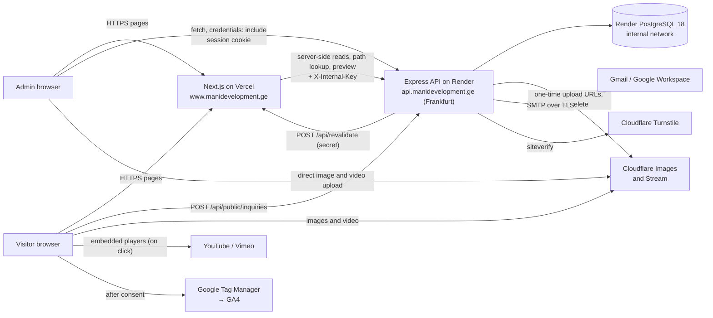
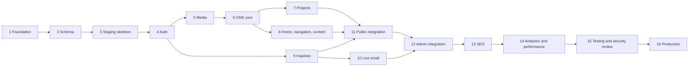

# Master Plan

**Project:** MANI DEVELOPMENT corporate website with a simple CMS (`client/`, Next.js 16) and a new backend in `server/`
**Domain:** `manidevelopment.ge`
**Status:** PLANNING ONLY. No application code has been written. Phase 1 starts only after your explicit approval.
**Last updated:** 2026-11-20 (second revision, for the client requirements) · **Based on commit:** `5d41491`

This file keeps its original name, but since the second revision it covers the whole project: backend, CMS, public site integration, SEO, analytics and performance.

---

## 0. Document map

| Document | Contents |
|---|---|
| [REQUIREMENTS_TRACEABILITY.md](REQUIREMENTS_TRACEABILITY.md) | Every client requirement → current state → design section → phase → MVP or later |
| [FRONTEND_REQUIREMENTS_AUDIT.md](FRONTEND_REQUIREMENTS_AUDIT.md) | What the frontend does today, with file evidence; §7 compares it with the client requirements |
| [DATABASE_DESIGN.md](DATABASE_DESIGN.md) | PostgreSQL/Prisma models, constraints, transactions, migrations, backups |
| [API_CONTRACTS.md](API_CONTRACTS.md) | Every endpoint; §8 covers blocks, pages, navigation, slides, redirects, sitemap and preview |
| [SECURITY_PLAN.md](SECURITY_PLAN.md) | Auth, sessions, access control, validation, rate limits, secrets; §17 covers CMS content, preview and the site's Content-Security-Policy |
| [SEO_ANALYTICS_PERFORMANCE.md](SEO_ANALYTICS_PERFORMANCE.md) | URL and language structure, metadata, sitemap, structured data, redirects, analytics, consent, contact links, speed targets |
| [INTEGRATIONS.md](INTEGRATIONS.md) | Cloudflare (images, video), email, Render, Vercel, domain and DNS, Next.js behaviour, sources |
| [TESTING_STRATEGY.md](TESTING_STRATEGY.md) | Test layers, tooling, CI, quality gates; §10 covers CMS, SEO, analytics and performance checks |
| [OPEN_QUESTIONS.md](OPEN_QUESTIONS.md) | Decisions needed from you, prioritized |
| [EVIDENCE_REGISTER.md](EVIDENCE_REGISTER.md) | Every significant fact or decision, classified |

This file holds the architecture, the phased roadmap with the per-phase specification, the risk register and the record of what changed in each revision (§8).

---

## 1. Executive summary

- **There is no backend today.** The frontend is a polished prototype:
  - Every piece of data lives in the visitor's own browser storage.
  - Admin "login" is a browser flag with the demo password printed on the login page.
  - Uploads and the contact form are simulated.
- **The client requirements go well beyond the prototype.** Measured against them (audit §7), the frontend has no slider, editable navigation, page editor, video, draft or preview workflow, sitemap, robots file, structured data, redirects, analytics, consent handling, WhatsApp or Messenger links, or Google Maps link. It does have the design, the admin screens for seven content types, and direct-call links.
- **Recommended architecture:**
  - One TypeScript Express 5 service and one PostgreSQL database (Prisma 7.10.1, pinned), on Render in Frankfurt.
  - A **hybrid CMS**: the existing designed pages stay, with editable headings, intros, SEO fields and added content blocks; new pages are built entirely from blocks.
  - Six block types (heading, text, image, gallery, video, embed), stored as validated data, never HTML.
  - Images on Cloudflare Images, uploaded video on Cloudflare Stream, YouTube and Vimeo links as embeds.
  - Draft → preview → publish for projects and pages, with preview links that work across the two domains.
  - SEO built into the data model: optional SEO fields with automatic defaults, generated canonical and language links, sitemap, structured data, and automatic redirects when an address changes.
  - Analytics through Google Tag Manager only, loaded after consent, with two tracked events.
- **Your answers so far:** domain `manidevelopment.ge`; mainly Georgian content; one admin with an email reset link; Gmail (Google Workspace); you are buying the hosting.
- **Your latest answers (2026-11-20) unblock the database design:** no separate product catalogue; the slider is its own homepage section and the 3D opening stays; the hybrid CMS; text formatting; Georgian first; uploaded and embedded video; `info@` for login, sending and inquiries; you manage DNS.
- **Verified facts that affect cost and risk:**
  - Render's free tier and Vercel's Hobby plan are unsuitable for a company site.
  - Uploaded video costs at least $5/month.
  - No site is live on the domain today, so there are no old addresses to redirect.
  - The domain's email signing (DKIM, DMARC) is not set up yet.

---

## 2. Scope

**First release (MVP):** every requirement marked MVP in REQUIREMENTS_TRACEABILITY §1–6. In short:
- **Backend:** authentication with email reset; media (images, video); pages and blocks; projects; slider, navigation, services, team, testimonials, settings; inquiries with email; redirects; preview.
- **Website:** live data rendered on the server; slider; dynamic menu; block pages; contact buttons; SEO set; analytics with consent; speed targets.
- **Admin:** all management screens, including the block editor, with Georgian and English inputs.
- **Operations:** staging, production, backups, runbook.

**Later enhancements** (listed with reasons in REQUIREMENTS_TRACEABILITY §7): editing the designed sections' texts, version history, scheduled publishing, dropdown menus, embedded map, large videos, extra structured data, two-step login, roles, Georgian admin screens, error-tracking service.

**Out of scope:** microservices, job queues, Redis, GraphQL, public user accounts, e-commerce, a public site search.

**Still conditional on your approval:** Cloudflare Images (Q-04), Cloudflare Stream (Q-25), Turnstile (Q-09), the consent banner (Q-26), Playwright (Q-17).

---

## 3. Architecture

### 3.1 System context



### 3.2 Key choices

**Language: TypeScript (PROPOSED).**
- The frontend is TypeScript.
- Prisma 7 generates TypeScript types and Zod infers request types, so one schema drives both validation and types.
- **Build:** `tsc` to `dist/`, run with `node dist/index.js`.
- **Dev and scripts:** `tsx`.
- **Not using Node's native type stripping for production:** it's stable in Node 24.12+ (VERIFIED), but it forbids enums and path aliases, and the Prisma-generated client hasn't been checked against it.

**Modules: ESM** (`"type": "module"`), which Prisma 7 requires (VERIFIED).

**Runtime: Node 24 LTS, `>=24.19.0`** (stable built-in Argon2id). Q-15 covers the Node 26 alternative.

**Structure:**
- Feature modules, each with `*.routes.ts` (HTTP + validation), `*.service.ts` (business rules + Prisma), `*.schemas.ts` (Zod) and `*.serializers.ts` (DB row → API shape).
- **No** controller/repository/DI layers. Services receive dependencies (Prisma client, clock, integrations) as plain function arguments, created once in `createApp`.

**`createApp(deps)` returns an Express app without listening.**
- Tests build it with fakes.
- `index.ts` builds it with real dependencies, then listens on `0.0.0.0:$PORT` and handles `SIGTERM`.

**Configuration:**
- `src/config/env.ts` parses `process.env` once with Zod (contract: INTEGRATIONS §9).
- Nothing else reads `process.env` (enforced by an ESLint rule).

**Request pipeline:**
`helmet` → request ID + `pino-http` → `cors` (per route group) → `express.json({limit:'100kb'})` → rate limiter (per route group) → router (`/api/health`, `/api/public`, `/api/auth`, `/api/admin` + `requireAdmin` + origin check, `/api/preview` + internal key) → Zod validation → service → serializer → JSON. Errors go to one error middleware (envelope in API_CONTRACTS §1).

**Error mapping:**

| Source | Result |
|---|---|
| `ZodError` | 400 `VALIDATION_FAILED` |
| Prisma `P2002` (unique) | 409 (e.g. `SLUG_TAKEN`) |
| Prisma `P2003` (foreign key) | 422 `INVALID_REFERENCE` or 409 `MEDIA_IN_USE` |
| Prisma `P2025` (not found) | 404 |
| Body-parser errors | 400 / 413 / 415 |
| Anything else | 500 `INTERNAL` (logged with stack; response without) |

**Background work:**
- Session cleanup, abandoned-upload sweep and email outbox run in-process on timers (`unref`, single-flight).
- The outbox claims rows with `FOR UPDATE SKIP LOCKED`, so it stays correct even if a second instance is ever added.
- **No queue infrastructure** is justified at this volume.

**CMS design in one paragraph (added in the second revision):**
- Content that has its own address (projects, pages) carries the same small set of things: a slug, a title that is the page's H1, an ordered list of blocks, a Published switch and optional SEO fields.
- That set is implemented **once**, as shared helpers for blocks, SEO defaults, slug changes and redirects (the `content` module), and reused by projects and pages. It is a few functions, not a framework.
- List-style content (services, team, testimonials, slides, menu items) stays as simple tables with a show/hide switch and an order.

**Where SEO and analytics live:**
- The API owns the **data**: SEO fields and defaults, published state, redirects, the sitemap feed, the settings for Tag Manager and Search Console.
- The Next.js site owns the **output**: metadata, canonical and language links, sitemap and robots files, structured data, the redirect and 404 decisions in `proxy.ts`, the consent banner and the Tag Manager loader.

### 3.3 Directory structure (target; created phase by phase)

```
server/
├── docs/                         # this planning package
├── prisma/
│   ├── schema.prisma             # P1 (generator + datasource), P2 (models)
│   ├── migrations/               # P2+
│   └── seed.ts                   # P2 (development seed ported from client/data/seed.ts)
├── prisma.config.ts              # P1 (Prisma 7: datasource URL, seed command)
├── src/
│   ├── index.ts                  # P1 process entry: env → db → app → listen → graceful shutdown
│   ├── app.ts                    # P1 createApp(deps)
│   ├── config/env.ts             # P1
│   ├── lib/                      # P1 db.ts, logger.ts, errors.ts, validate.ts, clock.ts; P2 slug.ts, enum-map.ts
│   ├── middleware/               # P1 request-context, error-handler, not-found
│   │                             # P4 require-admin, origin-check, rate-limits; P6 require-internal-key
│   ├── modules/
│   │   ├── health/               # P1
│   │   ├── auth/                 # P4
│   │   ├── media/                # P5
│   │   ├── content/              # P6 shared: blocks, rich-text schema, embeds, SEO defaults, publishing, redirects
│   │   ├── pages/  preview/      # P6
│   │   ├── projects/             # P7
│   │   ├── slides/  navigation/  company-services/  team/  testimonials/  settings/   # P8
│   │   ├── inquiries/  notifications/  activity/  dashboard/  search/  email/        # P9
│   ├── integrations/             # P4 mailer; P5 cloudflare-images, cloudflare-stream; P6 revalidator
│   │                             # P9 turnstile; P10 smtp-mailer
│   ├── jobs/                     # P4 session-cleanup; P5 media-sweep; P9 email-outbox
│   └── generated/prisma/         # Prisma client output (generated, git-ignored)
├── scripts/                      # P4 admin-create, admin-set-password; P5 media-reconcile
├── test/                         # setup/, helpers/, integration/, security/, adapters/
├── docker-compose.yml            # P1 local PostgreSQL 18 for dev + test
├── render.yaml                   # P3
├── eslint.config.js  tsconfig.json  tsconfig.build.json  vitest.config.ts
├── .env.example  .gitignore  .node-version
└── package.json  package-lock.json
```

New frontend files appear in Phases 11–14 (listed in those phase specs). Nothing in `client/` changes before Phase 11.

### 3.4 Dependencies

Each one is justified; versions are pinned exactly at install time.

**Server:**

| Package | Why | Phase |
|---|---|---|
| `express` 5.x | Required stack; native async error forwarding | 1 |
| `helmet` | Security headers | 1 |
| `cors` | Exact-origin CORS with credentials | 1 |
| `zod` 4.x | Env, request and response validation + inferred types; also the rich-text allow-list | 1 |
| `pino`, `pino-http` | Structured logs with redaction | 1 |
| `@prisma/client` + `@prisma/adapter-pg` + `pg` (Prisma **7.10.1**) | Required ORM; the adapter is mandatory in v7. An npm `overrides` entry pins Prisma's config loader to `effect` 3.22.5 to clear a high-severity advisory (EVIDENCE_REGISTER C-28) | 1 |
| `dotenv` | Prisma 7 no longer loads `.env`; its docs use `dotenv/config` in `prisma.config.ts` | 1 |
| `express-rate-limit` | Login, contact and API limits | 4 |
| `nodemailer` | SMTP to Gmail / Google Workspace | 10 |
| **dev:** `typescript` (**6.0.3**; TypeScript 7 is not yet supported by typescript-eslint), `tsx`, `prisma` (CLI, pinned 7.10.1), `vitest` + `vite`, `supertest`, `eslint`, `@eslint/js`, `typescript-eslint`, `globals`, `@types/*` | Build, test, lint | 1 |

**Frontend additions (second revision):**

| Package | Why | Phase |
|---|---|---|
| `@tiptap/react`, `@tiptap/starter-kit`, `@tiptap/pm` (3.x, MIT) | Rich-text editing inside text blocks, **admin only**, lazy-loaded. Only if Q-22 = yes | 12 |
| `@playwright/test` (dev only) | Browser smoke tests. Only if Q-17 = yes | 12 |

**Deliberately not used:**
- Server: `express-session`, `passport`, `jsonwebtoken` (small custom DB sessions instead); `bcrypt`, `argon2` (built-in `crypto.argon2`); `multer`, `sharp`, `@aws-sdk/*` (no file bytes pass through the server); `axios` (built-in `fetch`); an HTML sanitizer (content is never HTML).
- Frontend: a slider library, a consent-management library, `@next/third-parties` (experimental), a drag-and-drop library (the block list reorders with the same up/down pattern the admin already uses), a public-site rich-text library (a small custom renderer instead).

### 3.5 Environments

| Env | API | Database | Frontend | Integrations |
|---|---|---|---|---|
| development | `localhost:4000` | Docker/local PG 18 `mani_dev` | `localhost:3000` | Fakes by default; real dev keys optional |
| test | in-process (Supertest) | `mani_test` (refused unless the name ends in `_test`) | — | Fakes |
| staging (Q-14) | Render, `api-staging.manidevelopment.ge` | separate Render PG | `staging.manidevelopment.ge` on Vercel, **noindex** | Real, with test keys; no Tag Manager ID. Cloudflare items tagged `metadata.env = "staging"` |
| production | Render, `api.manidevelopment.ge` | Render PG (paid, PITR) | `www.manidevelopment.ge` on Vercel | Real |

---

## 4. Phase roadmap

### 4.1 Changes in this revision, and why

The first revision had 12 phases. The second has 16.

| Was | Now | Reason |
|---|---|---|
| 1 Foundation | **1 Foundation** | Unchanged |
| 2 Schema | **2 Database schema and migrations** | Expanded: pages, blocks, slides, navigation, redirects, publishing, SEO fields, video, new settings |
| 3 Staging skeleton | **3 Staging deployment skeleton** | Unchanged; adds DNS and Vercel checks |
| 4 Auth | **4 Authentication and password reset** | Unchanged |
| 8 Media | **5 Media: images and video** | **Moved earlier.** Blocks, slides and projects all reference media and video states, so building media first avoids rework and exposes the Cloudflare unknowns before content depends on them. It also matches the sequence suggested with the client requirements |
| — | **6 CMS core: pages, blocks, publishing, preview, redirects** | **New.** The shared content machinery, built once and reused |
| 5 Projects | **7 Projects ("products")** | Now with blocks, publishing and SEO fields from Phase 6 |
| 6 Site content | **8 Homepage, navigation, site content and settings** | Adds the slider, navigation and the new settings |
| 7 Inquiries | **9 Inquiries, notifications, dashboard, search** | Unchanged |
| 9 Email | **10 Live email (Gmail)** | Unchanged; adds DKIM and DMARC, which DNS shows are missing |
| 10 Frontend integration (three slices) | **11 Public website integration** and **12 Admin panel integration** | Split into two phases, because each is large and separately verifiable |
| — | **13 SEO implementation** | **New** |
| — | **14 Analytics, consent and performance** | **New** |
| 11 Hardening | **15 Testing, security review and reliability** | Unchanged in purpose |
| 12 Production | **16 Production deployment and launch** | Adds Search Console and analytics checks |

**Where this differs from the suggested 10-step sequence, and why:**
- A staging deployment comes third instead of last. Deployment problems are cheapest to find while the app is tiny.
- Inquiries and email are their own phases; the suggested sequence didn't list them, but the contact form needs them.
- Public integration comes before admin integration: the public read path can be verified with seeded data before the admin forms exist.
- SEO comes after both integrations, because it needs real pages to check and the admin's SEO fields to exist.

### 4.2 Dependencies between phases



| Phase | Waits on your answers | Waits on phases |
|---|---|---|
| 1 | none (Q-15 and Q-18 have defaults) | — |
| 2 | none blocking (Q-32 and Q-23 use their defaults) | 1 |
| 3 | **accounts you are purchasing (Q-08)**, Q-14, Q-28, Q-33 | 1, 2 |
| 4 | Q-28 (staging DNS), Q-29 (admin address) | 2, 3 |
| 5 | **Q-04, Q-25**, Q-11 | 4 |
| 6 | (Q-21, Q-22 through the schema) | 5 |
| 7 | (Q-19 through the schema) | 6 |
| 8 | Q-24 (values can be entered later) | 6 |
| 9 | Q-09, Q-29(4) | 4 |
| 10 | **Q-29**, DNS access (Q-28) | 4, 9 |
| 11 | Q-20, Q-02a(2), Q-24, Q-16 | 7, 8, 9 |
| 12 | Q-17 | 10, 11 |
| 13 | Q-31, Q-33 | 12 |
| 14 | **Q-26** | 13 |
| 15 | Q-12 | 14 |
| 16 | Q-10, Q-13, Q-27 | 15 |

- Phases 7 and 8 can run in either order or side by side. Phase 9 can start any time after Phase 4.
- **If Cloudflare credentials arrive late,** Phases 6–9 can proceed on the media model and the fake provider, and only the Phase 5 staging check waits.

**Rule:** no phase starts until the previous phase meets its acceptance criteria, with evidence (TESTING_STRATEGY §8).

---

## 5. Phase specifications

Every phase lists the same 14 items: scope and objectives, dependencies, tasks, files, database changes, API contracts, unit tests, integration tests, security checks, manual verification, expected results, acceptance criteria, rollback, definition of done. Items 3, 4 and 6 are the phase's deliverables; items 7–11 are its verification steps; item 12 is measurable.

Test layers and the per-endpoint matrix are defined once in TESTING_STRATEGY §4–5 and §10; endpoints in API_CONTRACTS; tables in DATABASE_DESIGN.

### Phase 1 — Server foundation

1. **Scope and objectives:** a runnable, tested, empty service. Configuration validation, logging, security middleware, error handling, health endpoints, Prisma wired to PostgreSQL, a test harness, lint and type checks. **No business features, no models, no migrations.**
2. **Dependencies:**
   - **Local:** Node **≥ 24.19** (yours is 24.15, so it must be upgraded); PostgreSQL 18 via Docker or local install (both present).
   - **Answers:** none; defaults are Q-15 = Node 24 and Q-18 = GitHub Actions. If you decline CI, the workflow file is skipped.
3. **Tasks:**
   1. Scaffold `server/package.json` (`private`, `"type":"module"`, `engines.node: ">=24.19 <25"`) with scripts:
      - `dev` = `tsx watch src/index.ts`
      - `build` = `tsc -p tsconfig.build.json`
      - `start` = `node dist/index.js`
      - `test` = `vitest run`
      - `typecheck`, `lint`
      - `db:up` = `docker compose up -d`
      - `prisma:generate`
   2. Install the Phase 1 dependencies (§3.4) with exact versions; commit `package-lock.json`.
   3. `tsconfig.json` (strict, `module`/`moduleResolution` `NodeNext`, target ES2023) and `tsconfig.build.json` (excludes tests).
   4. `src/config/env.ts`: Zod schema for `NODE_ENV`, `PORT`, `DATABASE_URL`, `CORS_ORIGINS`, `LOG_LEVEL`, `TRUST_PROXY_HOPS` (required when production). Exits with a list of every invalid or missing variable.
   5. `src/lib/logger.ts` (pino + redaction list from SECURITY_PLAN §8); `src/middleware/request-context.ts` (`randomUUID` request ID, `X-Request-Id`, pino-http).
   6. `src/lib/errors.ts` (`AppError`), `src/middleware/error-handler.ts` (envelope, Zod/Prisma/body-parser mapping, no stack in responses), `src/middleware/not-found.ts`, `src/lib/validate.ts` (Zod helper for body/query/params).
   7. `src/app.ts` with:
      - `createApp({ config, prisma, logger })`
      - `x-powered-by` off, `trust proxy` from config, helmet, CORS from `CORS_ORIGINS`
      - `express.json({limit:'100kb', strict:true})`
      - health router, 404, error handler
   8. Prisma:
      - `prisma/schema.prisma` (generator `prisma-client`, `output = "../src/generated/prisma"`, `moduleFormat = "esm"`; datasource `postgresql`; no models)
      - `prisma.config.ts` (`dotenv/config`, datasource URL)
      - `src/lib/db.ts` (`PrismaPg` adapter, pool `max` 10)
      - **Check** whether `prisma generate` accepts a schema with no models. If it doesn't, the readiness probe uses the adapter's `pg` pool directly until Phase 2. Record the result in EVIDENCE_REGISTER.
   9. `src/modules/health/health.routes.ts`: `GET /api/health/live`, `GET /api/health/ready` (`SELECT 1`, 2 s timeout → 503).
   10. `src/index.ts`:
       - listen on `0.0.0.0:PORT`
       - on `SIGTERM`/`SIGINT`: stop accepting connections, finish in-flight requests (10 s cap), `prisma.$disconnect()`, exit 0
       - unhandled rejection: log + exit 1
   11. `docker-compose.yml` (PG 18, `mani_dev` and `mani_test`), `.env.example`, `.gitignore` (`node_modules`, `dist`, `.env*` except `.env.example`, `src/generated`), `.node-version` (current 24.x at implementation time).
   12. `eslint.config.js` (typescript-eslint recommended; ban `$queryRawUnsafe`/`$executeRawUnsafe`; ban `process.env` outside `src/config`).
   13. `vitest.config.ts` (unit + integration projects; integration `fileParallelism:false`; global setup with the `_test` database guard).
   14. `.github/workflows/server-ci.yml` (if Q-18 = yes): TESTING_STRATEGY §7 steps 1–5, 7, 8. The drift check arrives in Phase 2.
   15. `server/README.md`: prerequisites, setup, commands.
4. **Files to create:** everything listed in task 3 (all new, under `server/`; plus `.github/workflows/server-ci.yml` at the repo root). **Nothing in `client/` is modified.**
5. **Database changes:** none (no models, no migrations). Docker creates the empty `mani_dev` and `mani_test` databases.
6. **API contracts:** `GET /api/health/live`, `GET /api/health/ready` (API_CONTRACTS §3); 404 envelope for unknown routes.
7. **Unit tests:**
   - env: valid input parses; each required variable missing → error naming it; malformed `DATABASE_URL`/`CORS_ORIGINS` rejected; `TRUST_PROXY_HOPS` required when production
   - error mapping: ZodError → 400 with `fieldErrors` codes; AppError passthrough; unknown error → 500 without message leak
   - validate helper
8. **Integration tests:**
   - `live` → 200
   - `ready` with the database up → 200; `ready` with an unreachable database URL → 503 within ~2.5 s
   - unknown route → 404 envelope; malformed JSON → 400 `MALFORMED_JSON`; 101 kB body → 413; non-JSON POST → 415 (test-only route mounted via a `createApp` option)
   - thrown error → 500 with `requestId` and no stack
   - `X-Request-Id` present
   - helmet headers present; `X-Powered-By` absent
   - CORS: allowed origin echoed, other origins get no `Access-Control-Allow-Origin`
9. **Security checks:**
   - `git check-ignore` confirms `.env` is ignored
   - `npm audit --omit=dev` shows no high or critical findings
   - the log-redaction unit test passes (cookie and authorization headers redacted)
   - the ESLint bans trigger on a deliberate sample (then removed)
10. **Manual verification:**
    1. `npm ci && npm run db:up && npm run dev`, then `curl -i localhost:4000/api/health/live` and `/ready`.
    2. Stop the database container: `/ready` → 503; restart it: → 200.
    3. Start with `DATABASE_URL` unset: the process exits non-zero with a clear message.
    4. `npm run build && npm start` serves the same responses from `dist/`.
    5. Send `SIGINT`: shutdown is logged and the exit code is 0.
11. **Expected results:** all of the above, plus green `test`, `typecheck` and `lint`.
12. **Acceptance criteria:**
    - the server starts with valid configuration and refuses to start with invalid configuration
    - health endpoints behave as specified, including database-down
    - all foundation tests pass locally (and in CI if enabled)
    - Supertest works with Express 5 (A-04), or the documented fallback is in place
13. **Rollback:** all work is additive inside `server/` (and one workflow file). Revert the commit(s). Nothing is deployed.
14. **Definition of done:** acceptance criteria met; phase report with command outputs and the manual verification table; EVIDENCE_REGISTER updated (empty-schema `generate` result, A-04); your sign-off before Phase 2.

### Phase 2 — Database schema and migrations

1. **Scope:** implement every model in DATABASE_DESIGN §3, adjusted for your answers:
   - authentication tables, media (images and video), projects with specs and gallery
   - **CMS tables:** pages, content blocks and their media links, navigation items, homepage slides, redirects
   - services, team, testimonials, inquiries with notes, notifications, activity log, settings (including contact channels, SEO and analytics fields)
   - bilingual `*Ka` / `*En` columns, publishing flags and the shared SEO fields
   - hand-added `CHECK` constraints; the settings row; the five system pages; the current menu as navigation rows; the development seed
2. **Dependencies:** Phase 1. The blocking questions were answered on 2026-11-20; Q-32 and Q-23 use their defaults unless changed.
3. **Tasks:**
   - write the models
   - `prisma migrate dev --create-only` → add `CHECK` constraints, the settings row, the system pages and the default navigation → apply
   - enum mapping helper + test (D-15)
   - Georgian→Latin transliteration helper for slugs (`src/lib/slug.ts`), with the reserved-slug list
   - `prisma/seed.ts` ported from `client/data/seed.ts` (`STATIC` media provider), with Georgian text from `client/i18n/content/ka.json`, a few sample slides, one sample custom page with every block type, and seed slugs for services
   - seed command in `prisma.config.ts`
   - CI drift check command (verified against Prisma 7 docs at that time)
   - test helpers: `resetDb()` and small fixture builders
4. **Files:** `prisma/schema.prisma`, `prisma/migrations/<timestamp>_init/migration.sql`, `prisma/seed.ts`, `prisma.config.ts`, `src/lib/enum-map.ts`, `src/lib/slug.ts`, `test/helpers/db.ts`, `test/helpers/fixtures.ts`, the CI workflow.
5. **Database changes:** the initial migration creates every table, enum, index and `CHECK` in DATABASE_DESIGN, plus `site_settings` row id=1, five system `Page` rows and the default `NavigationItem` rows.
6. **API contracts:** none (no new endpoints).
7. **Unit tests:**
   - the enum map round-trips every value
   - fixture builders produce valid rows
   - transliteration covers all 33 Georgian letters and produces valid slugs (e.g. "ვაკის ტერასები" → `vakis-terasebi`); reserved slugs are detected
8. **Integration tests (DB level):**
   - each `CHECK` rejects a violating insert: progress 101, end before start, completed without date, bad slug, second settings row, a block with both or neither owner, a navigation item with both or neither target, an unpublished system page
   - unique slugs (project, page, service) and unique `Redirect.fromPath`
   - CASCADE (project → specs, gallery, blocks; page → blocks and navigation items; block → media links; inquiry → notes and notifications)
   - RESTRICT (media used by a cover, gallery, block, slide, service or team member can't be deleted)
   - SET NULL (testimonial project, activity actor, social images)
   - the seed runs twice without error (idempotent upserts)
   - `migrate deploy` on an empty database matches `schema.prisma` (drift check)
9. **Security checks:** no credentials in the seed (no admin user is seeded); migration SQL reviewed for accidental data exposure (e.g. default values).
10. **Manual verification:** `npm run migrate:dev`, `npx prisma db seed`, inspect tables with `psql \d+`, run `npx prisma studio` locally to view the seeded rows.
11. **Expected results:** the database matches DATABASE_DESIGN; all constraint tests pass.
12. **Acceptance criteria:**
    - the migration applies cleanly to an empty database with `migrate deploy`
    - **every** constraint and referential behaviour in DATABASE_DESIGN §3–4 has a passing test (counted against the table in §4)
    - the seed loads, and a second run changes nothing
13. **Rollback:** before any shared environment exists, drop and recreate the local databases. Once deployed (Phase 3+), only forward-fix migrations (DATABASE_DESIGN §7).
14. **Definition of done:** as Phase 1, plus DATABASE_DESIGN updated with any implementation differences.

### Phase 3 — Staging deployment skeleton

1. **Scope:** deploy the Phase 1–2 service to Render with a database. Prove pre-deploy migrations, health checks, rollback, CI gating and latency. **Measure the client-IP headers** (B-03).
2. **Dependencies:** Phases 1–2; **the Render and Vercel accounts you are purchasing (Q-08), Q-14**; GitHub repo access for Render; DNS access (Q-28) and the main-address decision (Q-33). The API skeleton can go live on `*.onrender.com` first if DNS access takes time, because there are no cookies yet.
3. **Tasks:**
   - `render.yaml` with:
     - web service: `runtime: node`, region `frankfurt`, `buildCommand: npm ci && npm run prisma:generate && npm run build`, `preDeployCommand: npx prisma migrate deploy`, `startCommand: npm start`, `healthCheckPath: /api/health/ready`
     - database: PG 18, Frankfurt
     - env group with `sync: false` secrets
   - create the services and deploy
   - temporarily set `LOG_LEVEL=debug` with a one-off log line in the request context listing `X-Forwarded-For`, `CF-Connecting-IP` and `req.ips`; make requests from a known IP; decide `TRUST_PROXY_HOPS` or the `CF-Connecting-IP` strategy; remove the log line
   - measure p50/p95 latency of `/api/health/live` from Georgia (or the closest available location)
   - add the staging DNS records (`staging.` and `api-staging.manidevelopment.ge`, Q-28) and attach them to Vercel and Render
   - on the Vercel staging project: set `SITE_NOINDEX=true`, check what deployment protection the plan offers, and check whether server functions can run near Frankfurt (both NOT VERIFIED today)
   - rehearse a rollback via the dashboard
   - configure CI-gated deploys (verify the current Render setting; otherwise manual deploys)
4. **Files:** `server/render.yaml`; small edits to `src/middleware/request-context.ts` (temporary, then reverted); `server/docs/INTEGRATIONS.md` §4 update with the measurements.
5. **Database changes:** none beyond applying the Phase 2 migration on staging.
6. **API contracts:** unchanged.
7. **Unit tests:** the client-IP resolution function (once decided) with header fixtures.
8. **Integration tests:** existing suite passes in CI before the deploy.
9. **Security checks:**
   - the external database connection requires TLS, and the API uses the internal URL
   - the database IP allow-list is reviewed: the default is `0.0.0.0/0` (VERIFIED), so restrict it to none or office IPs if external access isn't needed
   - secrets exist only in Render's env group
   - HTTPS-only response headers verified with `curl -I`
10. **Manual verification:**
    - the deploy log shows `migrate deploy` ran
    - break the database URL in a test deploy and confirm the deploy is cancelled while the old version keeps serving
    - roll back and confirm
11. **Expected results:** a healthy staging URL; documented IP and latency findings.
12. **Acceptance criteria:**
    - `/api/health/ready` returns 200 on staging
    - a failed migration or health check provably blocks the deploy
    - the rollback procedure has been rehearsed
    - B-03 is resolved, with the evidence recorded
13. **Rollback:** delete the staging services. No production impact.
14. **Definition of done:** as Phase 1, plus the EVIDENCE_REGISTER and INTEGRATIONS updates.

### Phase 4 — Authentication and authorization

1. **Scope:** SECURITY_PLAN §2–5 and §9:
   - Argon2id passwords, DB sessions, cookie, login/logout/session/password endpoints
   - **email password reset** (request + confirm, Q-06)
   - `requireAdmin`, origin check, rate limiters
   - `admin:create` and `admin:set-password` scripts, session and reset-token cleanup job, `auth` activity entries
   - **The `Mailer` interface starts here:** a console transport for development (prints the email, including the reset link, to the local terminal only) and a fake for tests. Real Gmail delivery is connected in Phase 10.
2. **Dependencies:** Phases 2–3; DNS records for the staging names (Q-28); the admin login address (Q-29).
3. **Tasks:**
   - `password.ts` (hash/verify/PHC, dummy hash)
   - `session.ts` (create, lookup by hash, touch, revoke, revoke all)
   - `password-reset.ts` (token issue/verify/consume) + reset and "password changed" email templates (Georgian and English)
   - `src/integrations/mailer.ts` (interface, console transport, fake)
   - auth routes
   - middleware (`require-admin`, `origin-check`, `rate-limits`)
   - the scripts
   - the cleanup job
   - mount `/api/admin` behind the guard with a placeholder `GET /api/admin/ping` (returns the user; removed in Phase 5)
   - the route-walker security test
4. **Files:**
   - `src/modules/auth/{auth.routes,auth.service,auth.schemas,password,session,password-reset}.ts`
   - `src/modules/auth/emails/*` (reset and password-changed templates)
   - `src/integrations/mailer.ts`
   - `src/middleware/{require-admin,origin-check,rate-limits}.ts`
   - `src/jobs/session-cleanup.ts`
   - `scripts/{admin-create,admin-set-password}.ts`
   - `test/security/route-walker.test.ts`
   - auth integration tests
5. **Database changes:** none if Phase 2 created the `AdminUser`/`AdminSession` tables; otherwise a migration.
6. **API contracts:** API_CONTRACTS §4.
7. **Unit tests:** Argon2id round trip with OWASP parameters; PHC parse/format; a wrong password fails; dummy-hash path; session expiry math (idle and absolute) with an injected clock.
8. **Integration tests:**
   - login success sets a cookie with `HttpOnly`, `Secure`, `SameSite=Strict`, `Path=/` and no `Domain`
   - wrong password → 401; unknown email → 401 with similar timing (assert that both paths call verify, not wall-clock time)
   - lockout after 10 failures; IP rate limit → 429
   - logout invalidates the session server-side
   - an expired session → 401
   - a password change revokes the other sessions
   - **reset:**
     - request for an unknown email → 202 and no email (fake mailer records nothing)
     - request for the admin's email → 202 and one email to the **registered** address containing a fragment-only link
     - a second request invalidates the first token
     - confirm with a valid token → 204, password changed, all sessions revoked, "changed" notice sent
     - reused, expired (injected clock) or unknown token → identical 400
     - rate limits → 429
     - no raw token in the database or logs
   - origin check → 403
   - non-JSON → 415
   - the route walker passes
9. **Security checks:**
   - the console mail transport is refused at startup unless `NODE_ENV=development`, so reset links can never land in Render logs
   - the login response never says which field was wrong
   - cookies are absent from logs (redaction test)
   - `Cache-Control: no-store` is set on auth responses
   - no session token is stored in plain text (database check in a test)
10. **Manual verification:**
    - On staging with real sub-domains: create an admin with the script, then log in, check the session and log out with `curl` (cookie jar) and from a browser console on the staging site's origin. Repeat in Safari (the cookie must be accepted).
    - Locally: run the reset flow end to end with the console mailer (copy the printed link, set a new password, confirm the old session is gone).
11. **Expected results:** working login on staging in Chrome, Firefox and Safari.
12. **Acceptance criteria:** all auth tests pass; the route walker proves every admin route is protected; manual cross-browser login succeeds on staging.
13. **Rollback:** revert the deploy (no admin data exists yet). If a migration was added, forward-fix it.
14. **Definition of done:** as Phase 1, plus admin account(s) created on staging, with credentials handed over securely (not over chat).

### Phase 5 — Media: images and video

1. **Scope:** INTEGRATIONS §1.4–1.8 and §11, API_CONTRACTS §6.7:
   - image uploads through Cloudflare Images (one-time upload URL, completion, library list, edit, delete, bulk delete, "used by")
   - **video uploads through Cloudflare Stream** (one-time upload URL, `processing` → `ready`/`failed`), if Q-25 = yes
   - abandoned-upload sweep and the reconcile script
   - this is the first real admin API, so it also removes the Phase 4 placeholder route
2. **Dependencies:** Phase 4; **Q-04, Q-25**, Q-11; a Cloudflare account with Images Paid (and Stream), with API tokens scoped to Images and to Stream.
3. **Tasks:**
   - `src/integrations/cloudflare-images.ts` and `cloudflare-stream.ts` (create direct upload, get, delete; timeouts; one retry for GET/DELETE) + fakes
   - media module: validation, the `usedBy` lookup across covers, galleries, blocks, slides, services, team and social images
   - `jobs/media-sweep.ts`; `scripts/media-reconcile.ts` (dry-run default; filters by `metadata.env`)
   - enable flexible variants on the Cloudflare account
   - **staging check** with real credentials: resolves B-04 (how "not uploaded yet" looks for images), confirms the Stream states and the delivery URL formats
4. **Files:** `src/modules/media/*`, `src/integrations/cloudflare-images.ts`, `src/integrations/cloudflare-stream.ts`, `src/jobs/media-sweep.ts`, `scripts/media-reconcile.ts`, adapter and integration tests.
5. **Database changes:** none expected (Phase 2 created the media model).
6. **API contracts:** API_CONTRACTS §6.7.
7. **Unit tests:** upload input validation (image and video type allow-lists, 10 MB / 200 MB, dimensions, duration); delivery URL and thumbnail URL builders; sweep selection logic (age threshold); mapping of Stream states to our four statuses.
8. **Integration tests:**
   - image: upload → complete → ready (fake); complete before upload → 409
   - video: upload → complete → `processing` → `ready`; an encoding error → `failed`
   - Cloudflare 5xx → 502 with no row
   - delete in use → 409 with `usedBy`; delete unused → 204 and the remote delete is called after commit
   - bulk delete returns per-item results
   - the sweep removes stale pending rows and releases them remotely
   - adapter tests against a stub server (URLs, auth header, body, timeouts)
9. **Security checks:**
   - tokens never appear in responses or logs
   - only admins can request upload URLs; URL lifetime ≤ 5 minutes
   - SVG, GIF and unlisted video types are rejected at the API
   - each video's `allowedOrigins` is set to the site's hosts
10. **Manual verification (staging, real Cloudflare):**
    - upload a JPEG from the browser console, complete it, open the delivery URL at two widths, check AVIF or WebP is served, delete it and confirm it's gone at Cloudflare
    - attempt a 12 MB image (expect rejection)
    - upload a short MP4, watch it reach `ready`, play it in the Stream player, delete it
11. **Expected results:** as specified; findings recorded in EVIDENCE_REGISTER (B-04 and B-08 closed).
12. **Acceptance criteria:**
    - all tests green
    - the staging check passes end to end for one image and (if Q-25 = yes) one video
    - after an abandoned-upload test and one sweep run, the Cloudflare account holds **zero** items without a database row (checked with the reconcile script)
13. **Rollback:** revert the deploy. Items uploaded during testing are removed by the reconcile script (staging metadata only).
14. **Definition of done:** as Phase 1.

### Phase 6 — CMS core: pages, blocks, publishing, preview and redirects

1. **Scope:** the shared content machinery, built once (DATABASE_DESIGN §3.9, §3.12; API_CONTRACTS §8.1–8.3, §8.6–8.8; SECURITY_PLAN §17.1–17.3):
   - block validation and storage (six block types, the rich-text allow-list, embed parsing)
   - SEO fields with automatic defaults
   - publishing rules and the public/draft filter
   - pages: public read, admin CRUD (system and custom)
   - redirects: automatic on slug change, admin list, the public `resolve` lookup
   - the sitemap feed
   - preview tokens and the internal-key guard
   - the `ContentChanged` notifier interface for cache refresh (a no-op until Phase 11)
2. **Dependencies:** Phase 5; Phase 2 schema (which carries the Q-21 and Q-22 decisions).
3. **Tasks:**
   - `content/blocks.ts`: Zod schemas per block type, the recursive rich-text schema, limits; save (replace all) and load with media
   - `content/embeds.ts`: YouTube and Vimeo address parsing to provider + ID
   - `content/seo.ts`: input schema and the defaults resolver; `content/locales.ts`: language resolution and the English-availability rule (Q-32)
   - `content/publishing.ts`: publish, unpublish, `publishedAt`
   - `content/redirects.ts`: create on slug change, chain collapse, loop prevention; admin routes; `resolve`
   - pages module (routes, service, serializers); reserved-slug check
   - `preview` module: issue token, verify token; `require-internal-key` middleware; `?preview=1` handling in public reads
   - sitemap feed endpoint
   - `src/integrations/revalidator.ts` interface with a no-op implementation
4. **Files:** `src/modules/content/*`, `src/modules/pages/*`, `src/modules/preview/*`, `src/middleware/require-internal-key.ts`, `src/integrations/revalidator.ts`, tests.
5. **Database changes:** none expected. The `PreviewToken` table is created in Phase 2 (DATABASE_DESIGN §3.9).
6. **API contracts:** API_CONTRACTS §5 (pages, resolve, sitemap), §8.1–8.3, §8.6–8.8.
7. **Unit tests:**
   - every block type: valid and invalid shapes (TESTING_STRATEGY §10.1)
   - rich text: each disallowed node, mark, attribute and link scheme is rejected; depth and size limits
   - embeds: a table of accepted and rejected addresses
   - SEO defaults: every fallback step in DATABASE_DESIGN §3.9
   - redirect rules: create, re-point, delete-on-reuse, no self-redirect
8. **Integration tests:**
   - the TESTING_STRATEGY §5 matrix for pages and redirects
   - saving a page replaces its blocks atomically (a bad block leaves the old list intact)
   - drafts are absent from public reads, `resolve` and the sitemap feed; present with the internal key and `?preview=1`
   - system pages can't be deleted, unpublished or re-slugged
   - a published slug change produces one redirect; a draft's change produces none
   - preview tokens: single use, 5-minute expiry, bound to one record
   - records without an English title are absent from `?locale=en` responses
9. **Security checks:**
   - no route returns a draft without the internal key (route walker extended to `/api/preview/*` and `?preview=1`)
   - redirect targets and link `href`s can't leave the site or use script schemes
   - `resolve` answers identically for a draft and for a non-existent path
10. **Manual verification:** on staging with `curl`: create a custom page with one block of each type, publish it, read it publicly in both languages, change its slug, and confirm `resolve` returns the redirect.
11. **Expected results:** responses match API_CONTRACTS §8 exactly (contract tests).
12. **Acceptance criteria:**
    - all tests green, including every row of TESTING_STRATEGY §10.1 that belongs to this phase
    - 100% of the block and rich-text rejection cases listed in API_CONTRACTS §8.1 have a test
    - zero public responses contain a draft (dedicated test over every public endpoint)
13. **Rollback:** revert the deploy; no schema changes.
14. **Definition of done:** as Phase 1.

### Phase 7 — Projects ("products") API

1. **Scope:** public and admin project endpoints (API_CONTRACTS §5, §6.1), with specs, ordered gallery, cover, inline status and featured changes, activity entries, and, from Phase 6, blocks, publishing, SEO fields and slug redirects.
2. **Dependencies:** Phase 6; the Phase 2 schema (which carries the Q-19 decision).
3. **Tasks:** schemas (every rule from `ProjectForm.tsx:43-61` plus maximums), service (transactions per DATABASE_DESIGN §5), serializers (`ProjectCard`, `ProjectDetail`, enum mapping, `Image` objects, resolved `seo`), routes; reuse of the `content` helpers.
4. **Files:** `src/modules/projects/*`, tests.
5. **Database changes:** none expected.
6. **API contracts:** as referenced above.
7. **Unit tests:** every validation rule; the "status completed → progress 100" rule; serializers; language fallback.
8. **Integration tests:**
   - the full TESTING_STRATEGY §5 matrix
   - gallery, spec and block order preserved across updates
   - slug conflict; slug change on a published project creates a redirect
   - invalid media reference → 422 with no partial write
   - delete cascades; a testimonial keeps `project: null`
   - the public list and detail shapes; drafts hidden; English rule applied
9. **Security checks:** public serializer field allow-list test; SQL metacharacters in `q` and text fields are stored and returned verbatim.
10. **Manual verification:** with the seeded staging database, create, edit, publish and delete a project with `curl`; read it from the public endpoint in both languages.
11. **Expected results:** responses match API_CONTRACTS §2 and §8 exactly (contract tests).
12. **Acceptance criteria:**
    - all project tests green
    - every validation rule in `ProjectForm.tsx:43-61` has a passing test
    - the response shapes contain every field the existing project components read (checked against the audit's field list)
13. **Rollback:** revert the deploy; no schema changes.
14. **Definition of done:** as Phase 1.

### Phase 8 — Homepage, navigation, site content and settings

1. **Scope:** API_CONTRACTS §5 (public lists, settings, navigation, slides), §6.2–6.4, §8.4–8.5:
   - **homepage slider** (CRUD, publish, reorder)
   - **navigation** (header and footer items, reorder)
   - services, team, testimonials (as before)
   - settings, including contact channels, default SEO values, the Search Console token and the Tag Manager ID
2. **Dependencies:** Phase 6 (can run alongside Phase 7).
3. **Tasks:** per resource: schemas (rules from `ServicesAdmin.tsx:105-110`, `TeamAdmin.tsx:102-107`, `TestimonialsAdmin.tsx:125-129`, `SettingsAdmin.tsx:19-29`, plus the new format checks in DATABASE_DESIGN §3.8), service with position handling (append, delete-and-compact, whole-list reorder with set check), serializers, routes, activity entries, `ContentChanged` calls.
4. **Files:** `src/modules/{slides,navigation,company-services,team,testimonials,settings}/*`, tests.
5. **Database changes:** none expected.
6. **API contracts:** as referenced above.
7. **Unit tests:** validation rules; position algorithms (append, compact, reorder) as pure functions; WhatsApp number, Messenger username, map URL, Tag Manager ID and verification-token format checks.
8. **Integration tests:**
   - the matrix for each resource
   - reorder: success, `409 ORDER_MISMATCH`, concurrent reorders leave positions contiguous
   - hidden services and members, unpublished testimonials and unpublished slides never appear publicly
   - a navigation item whose page is unpublished is absent publicly; deleting a page removes its items
   - limits: 8 slides, 12 navigation items per location
   - settings: a `javascript:` URL, a non-Google map URL and a malformed Tag Manager ID are rejected
9. **Security checks:** public visibility tests (above); public settings contain no admin-only data; navigation and button URLs can only be internal paths or `https:`.
10. **Manual verification:** with `curl` on staging: add and reorder slides and menu items, then confirm the public order; set and clear a WhatsApp number.
11. **Expected results:** as specified.
12. **Acceptance criteria:** all tests green; behaviour matches the audit F-04 to F-06 and F-10, and requirements CR-PW-02, CR-PW-08 and CR-CMS-09.
13. **Rollback:** revert the deploy.
14. **Definition of done:** as Phase 1.

### Phase 9 — Inquiries, notifications, activity, dashboard, search

1. **Scope:**
   - API_CONTRACTS §5 (`POST /api/public/inquiries`), §6.5, §6.6
   - contact-form abuse protection (SECURITY_PLAN §9; Turnstile if Q-09)
   - **the `EmailMessage` outbox:** company notification (and visitor acknowledgement if Q-29(4) = yes) enqueued in the inquiry transaction, plus the outbox worker, using the Phase 4 `Mailer` interface (fake/console until Phase 10)
2. **Dependencies:** Phase 4; Q-09; Q-29(4) for the acknowledgement email.
3. **Tasks:**
   - inquiry schemas (`ContactForm.tsx:18-26` + maximums), the honeypot, the Turnstile adapter (`src/integrations/turnstile.ts` + fake)
   - the submit transaction (inquiry + notification + activity)
   - the admin inbox (filters, search, pagination, counts, notes)
   - notifications (computed title, body and href)
   - activity list, dashboard aggregates (UTC months), search
4. **Files:** `src/modules/{inquiries,notifications,activity,dashboard,search,email}/*`, `src/jobs/email-outbox.ts`, `src/integrations/turnstile.ts`, tests.
5. **Database changes:** migration adding `EmailMessage` (DATABASE_DESIGN §3.6).
6. **API contracts:** as referenced above.
7. **Unit tests:** contact validation rules; month bucketing at boundaries; notification text builder.
8. **Integration tests:**
   - a submission creates exactly one inquiry, one notification and one activity entry, plus the outbox email row(s), in one transaction (forced failure → none of them)
   - outbox worker:
     - sends via the fake and marks `sent`
     - a failure schedules a retry with backoff; 5 failures → `failed`
     - two concurrent workers never send the same row (`SKIP LOCKED`)
   - email templates escape HTML; the acknowledgement does not contain the visitor's message
   - the honeypot returns 201 and stores nothing
   - Turnstile failure → 403 (fake)
   - rate limit → 429
   - inbox filters, search, pagination, counts
   - note belongs to its inquiry (404 otherwise)
   - deleting an inquiry cascades the notification
   - dashboard numbers match the fixtures
   - search returns at most 8 and is case-insensitive
9. **Security checks:**
   - inquiries are unreachable without a session (route walker)
   - no inquiry ID or internal data in the public response
   - personal data is absent from logs (assert on captured log output)
10. **Manual verification:** submit through `curl` to staging; see it in the inbox endpoints; verify Turnstile with Cloudflare test keys on staging (if Q-09).
11. **Expected results:** as specified.
12. **Acceptance criteria:** all tests green; spam controls proven by tests; Turnstile verified on staging if enabled.
13. **Rollback:** revert the deploy.
14. **Definition of done:** as Phase 1.

### Phase 10 — Live email (Gmail / Google Workspace SMTP)

1. **Scope:** INTEGRATIONS §3.3. Replace the console/fake transport with a real `nodemailer` adapter for `smtp.gmail.com:465`, used by:
   - the password-reset and "password changed" emails (Phase 4)
   - the inquiry outbox (Phase 9)

   Also covers email authentication DNS (SPF, DKIM, DMARC) and verification on staging.
2. **Dependencies:**
   - Phases 4 and 9
   - **Q-29 answers:** sending account, an app password created by you and entered directly in Render, notification recipient, Workspace super admin for DKIM
   - DNS access
3. **Tasks:**
   - `src/integrations/smtp-mailer.ts` (TLS required, timeouts, error classification: auth failure vs temporary)
   - transport selection by env (`smtp` in staging/production, `console` only in development, `fake` in tests)
   - check existing DNS records for SPF/DKIM before adding anything; turn on DKIM in the Workspace Admin console with the super admin; add DMARC `p=none`
   - if Q-29 chooses an alias as From, test whether Gmail preserves it
   - runbook entry for app-password rotation
4. **Files:** `src/integrations/smtp-mailer.ts`, env schema update, adapter tests (local SMTP sink), `server/docs/INTEGRATIONS.md` findings.
5. **Database changes:** none (the outbox exists since Phase 9).
6. **API contracts:** no new endpoints.
7. **Unit tests:** transport selection rules (console refused outside development); error classification; CR/LF rejected in header values.
8. **Integration tests:**
   - adapter against a local SMTP sink: correct From, To, Reply-To and TLS settings
   - an auth failure is marked non-retryable and logged clearly ("app password revoked?")
   - a temporary failure is retried per the backoff
9. **Security checks:**
   - the app password never appears in logs or error messages
   - TLS is required (no plaintext fallback)
   - reset emails go only to the registered address
10. **Manual verification (staging):**
    - submit an inquiry → it arrives in the notification inbox
    - request a password reset → the email arrives → the link works once and only once
    - check the `Authentication-Results` header shows **SPF pass and DKIM pass**
    - set a wrong app password → the outbox retries and the reset request still returns 202; fix it → queued mail is delivered
11. **Expected results:** as specified.
12. **Acceptance criteria:** all tests green; reset and inquiry emails delivered on staging with SPF and DKIM pass; failure recovery demonstrated.
13. **Rollback:** `EMAIL_ENABLED=false` stops sending (inquiries still saved, outbox keeps queuing; admin recovery via the CLI fallback); revert the deploy.
14. **Definition of done:** as Phase 1.

### Phase 11 — Public website integration

> The client uses Next.js 16 with breaking changes. Per `client/AGENTS.md`, read the bundled docs in `client/node_modules/next/dist/docs/` before writing client code; they couldn't be read during planning because `node_modules` isn't installed.

1. **Scope:** the public site reads everything from the API and renders it on the server.
   - an API client; server-side fetching for every public section with `'use cache'` + `cacheTag` + a time-based fallback; the `/api/revalidate` Route Handler
   - header and footer menus from the API; settings in the header, footer, logo and contact details
   - **homepage slider** (and the 3D house per Q-20)
   - a **generic page route** for custom pages and a **block renderer** (heading, text, image, gallery, video, embed)
   - project pages with blocks; images and video delivered from Cloudflare (custom image loader, click-to-play video)
   - **contact channels:** WhatsApp, Messenger, call and Google Maps links from settings
   - contact form → API (with Turnstile if Q-09 = yes)
   - **`proxy.ts`:** path lookup for redirects and real 404s; Georgian as the default language if Q-02a(2) = yes
   - **preview:** the `/api/preview` Route Handler and Draft Mode, with a visible "Preview" bar
   - `metadataBase` and working `generateMetadata` from API data (the full SEO pass is Phase 13)
2. **Dependencies:** Phases 7, 8, 9 deployed to staging; Q-20, Q-02a(2), Q-24, Q-16.
3. **Tasks:**
   - install dependencies and record a **baseline**: does the current build pass, and Lighthouse numbers for the five test pages (TESTING_STRATEGY §10.4)
   - `client/lib/api/*` (typed fetchers, cache tags, preview flag); environment variables (INTEGRATIONS §9)
   - convert sections to take data as props; make non-interactive sections server components
   - slider component without a library (CSS scroll-snap, small script, first image eager with high priority, fixed aspect ratio, pause on hover and focus, reduced-motion support)
   - block renderer and the rich-text renderer (no raw HTML); video and embed components with click-to-play posters
   - `client/lib/image-loader.ts` for Cloudflare Images flexible variants; `next.config.ts` loader settings
   - contact channel components; alt text from the media library
   - `proxy.ts`: call `/api/public/resolve` for dynamic routes only, 60-second in-memory cache, 308 redirects, 404 rewrite; locale default switch
   - make the project and page routes build with zero records (INTEGRATIONS §10 launch risk)
   - server side: replace the no-op revalidator with the HTTP implementation
   - cache spike on Vercel (resolves B-06); measure the proxy lookup time (A-09)
4. **Files:**
   - **Modify:** `client/lib/types.ts`, `client/components/ui/Img.tsx`, `client/next.config.ts`, `client/proxy.ts`, `client/i18n/config.ts`, `client/i18n/content.ts`, `client/components/sections/**`, `client/components/layout/*`, `client/components/brand/Logo.tsx`, `client/components/ui/ThemeSync.tsx`, `client/app/[lang]/layout.tsx`, `client/app/[lang]/not-found.tsx`, `client/app/[lang]/(site)/**`, `client/i18n/locales/{en,ka}/*.json` (new UI strings; `npm run i18n:check` must pass)
   - **Create:** `client/lib/api/*`, `client/lib/image-loader.ts`, `client/app/api/revalidate/route.ts`, `client/app/api/preview/route.ts`, `client/app/[lang]/(site)/[slug]/page.tsx`, `client/components/blocks/*`, `client/components/sections/home/Slider.tsx`, `client/components/contact/*`
   - **Server:** `src/integrations/revalidator.ts` (HTTP implementation)
5. **Database changes:** none.
6. **API contracts:** consumed as published. Any mismatch found is fixed in the API with a contract test, not worked around in the client.
7. **Unit tests:** image loader URL builder; block and rich-text renderers (each block type; no HTML injection path); embed URL builders; `proxy.ts` decision function (continue / redirect / 404) with a fake lookup; revalidate and preview handlers' secret checks.
8. **Integration tests:** `npm run build`, `npm run lint` and `npm run i18n:check` pass; on staging: edit in the API → the public page updates (revalidation round trip); a draft is invisible publicly and visible through a preview link.
9. **Security checks:**
   - no secret in any `NEXT_PUBLIC_*` variable (search the built client bundle for the secret values)
   - the revalidate and preview routes reject a bad secret or token
   - Draft Mode can't be switched on by guessing the URL
   - staging sends `X-Robots-Tag: noindex`
10. **Manual verification (staging; Chrome, Firefox, Safari; 360, 768 and 1280 px):**
    - every public page in Georgian and English, including a custom block page with all six block types
    - slider: keyboard and touch; images load; no layout jump
    - WhatsApp, Messenger, call and map links open the right target (Messenger behaviour recorded, since it is NOT VERIFIED)
    - contact form → inquiry in the database
    - an unknown address shows the 404 page; a changed slug redirects
11. **Expected results:** the public site shows live, shared data, with the new slider, menu, block pages and contact buttons.
12. **Acceptance criteria:**
    - zero imports of `lib/store` or `lib/session` remain in public components
    - an unknown address returns HTTP **404**; a changed slug returns **308** (checked with `curl -I`, both languages)
    - the build passes with an empty database
    - every page type passes the manual check at the three widths, with screenshots
    - the proxy lookup adds **≤ 100 ms** at the median for an uncached dynamic path (PROPOSED target; measured on staging)
13. **Rollback:** Vercel instant rollback to the previous deployment; the work lands as several separate pull requests (read path, slider and menu, blocks, proxy and preview), each revertible alone.
14. **Definition of done:** as Phase 1, plus the baseline measurements recorded.

### Phase 12 — Admin panel integration

1. **Scope:** the admin works against the API, and gains the new CMS screens.
   - login, logout, session, "Forgot password?" with `/admin/forgot-password` and `/admin/reset-password`
   - existing screens on the API: projects, services, team, testimonials, settings, inquiries, notifications, dashboard, search
   - **new screens:** pages (list and editor), **block editor**, homepage slider, navigation, redirects
   - **Georgian and English inputs** on every content form; transliterated slug suggestions
   - Published switch and **Preview** button on projects and pages; SEO fields with a "what Google will see" summary
   - media library on real uploads (images and video, with processing status); picker returns media IDs; "used by" and blocked deletes
   - remove the browser store, demo data, reset buttons, demo login and prototype notices; update the contact copy in both languages
   - Playwright smoke tests if Q-17 = yes
2. **Dependencies:** Phases 10 and 11; Q-17. The admin's data-fetching approach is decided at the start. PROPOSED: a thin typed `apiFetch` with no new dependency; reconsider a query library only if duplication or bugs show up.
3. **Tasks:**
   - auth screens and session handling; the admin UI shows nothing until the session is confirmed
   - shared form pieces: language-pair input, slug field, SEO panel, publish controls, media picker by ID
   - block editor: a list of blocks with add, move up/down, remove; one small form per block type; the rich-text control (Tiptap, lazy-loaded, restricted to the allowed formatting) if Q-22 = yes
   - screens for pages, slides, navigation and redirects, following the existing admin patterns (`ServicesAdmin.tsx` for ordered lists, `ProjectForm.tsx` for long forms)
   - media library: image and video upload flows, status polling for video
   - delete `client/lib/store.ts`, `client/lib/session.ts` and `client/data/seed.ts` once nothing imports them
4. **Files:**
   - **Modify:** every file in `client/components/admin/*`, `client/app/[lang]/admin/**`, `client/i18n/locales/{en,ka}/contact.json`
   - **Create:** `client/components/admin/{PagesAdmin,PageForm,BlockEditor,SlidesAdmin,NavigationAdmin,RedirectsAdmin,SeoPanel,LocalizedField}.tsx`, `client/components/admin/blocks/*`, `client/app/[lang]/admin/(panel)/{pages,slider,navigation,redirects}/**`, `client/app/[lang]/admin/{forgot-password,reset-password}/page.tsx`, Playwright tests
   - **Delete:** `client/lib/store.ts`, `client/lib/session.ts`, `client/data/seed.ts`
5. **Database changes:** none.
6. **API contracts:** consumed as published.
7. **Unit tests:** block editor state functions (add, move, remove, validate); language-pair and slug helpers; the mapping from API field-error codes to form messages.
8. **Integration tests:** build, lint and `i18n:check` pass. Playwright (if approved), on staging:
   - log in → create a project with an uploaded cover and a video block → preview it → publish → see it publicly
   - create a custom page with every block type → publish → open its address
   - reorder slides and menu items → the homepage reflects it
   - change a published slug → the old address redirects
   - forgot password → reset link → new password works
9. **Security checks:**
   - logout clears the UI state; a signed-out visit to any admin page shows only the login screen
   - the rich-text control can't produce a node or mark outside the allow-list (and the API rejects it anyway)
   - no analytics or third-party script loads in the admin
10. **Manual verification:** the same journeys by hand in Chrome, Firefox and Safari, on desktop and a phone-width window; keyboard-only pass through the block editor.
11. **Expected results:** the admin manages every content type against the real backend.
12. **Acceptance criteria:**
    - zero references to `lib/store`, `lib/session` or demo credentials remain in `client/`
    - every content type in REQUIREMENTS_TRACEABILITY §2 can be created, edited, deleted and (where listed) reordered, published and unpublished from the admin, each demonstrated once and recorded
    - all smoke tests pass (automated if Q-17 = yes, otherwise the written manual script)
13. **Rollback:** Vercel instant rollback; separate pull requests per area (auth, existing screens, CMS screens, media, cleanup).
14. **Definition of done:** as Phase 1.

### Phase 13 — SEO implementation

1. **Scope:** SEO_ANALYTICS_PERFORMANCE §1–7, on top of the data and routes from Phases 6–12:
   - metadata for every page type: title, description, canonical, `hreflang` with `x-default`, Open Graph and Twitter card with a social image, robots controls, the Search Console token
   - `sitemap.ts` and `robots.ts`
   - structured data: `WebSite`, `GeneralContractor`, `BreadcrumbList`
   - heading audit and the projects-index fix; alt text audit
   - the SEO check script (TESTING_STRATEGY §10.2)
2. **Dependencies:** Phase 12; Q-31 (earlier site addresses, if any), Q-33 (main address).
3. **Tasks:**
   - a shared `buildMetadata(seo, path, locale)` helper used by every route's `generateMetadata`
   - `client/app/sitemap.ts` from `/api/public/sitemap`; `client/app/robots.ts`
   - `client/components/seo/JsonLd.tsx` with `<` escaping; data from settings
   - Cloudflare image variant for 1200×630 social images
   - fix heading levels on the projects index; make sure slide headings aren't H1s
   - enter any earlier-site redirects (Q-31)
   - write `scripts/seo-check.mjs` (fetches the sitemap, then checks every address)
   - verify the two NOT VERIFIED Next.js points: `x-default` output and sitemap refresh after publishing
4. **Files:** `client/lib/seo/*`, `client/app/sitemap.ts`, `client/app/robots.ts`, `client/components/seo/JsonLd.tsx`, route files under `client/app/[lang]/(site)/**` (metadata), `client/components/sections/ProjectsExplorer.tsx` or `ProjectCard.tsx` (heading level), `client/scripts/seo-check.mjs`.
5. **Database changes:** none.
6. **API contracts:** unchanged; a gap found here is fixed in the API with a test.
7. **Unit tests:** `buildMetadata` for each page type and language (canonical, alternates, robots, social image fallback); JSON-LD builders (required fields present; `<` escaped); sitemap entry builder.
8. **Integration tests:** `scripts/seo-check.mjs` against staging: every row of TESTING_STRATEGY §10.2 that can be automated.
9. **Security checks:** JSON-LD can't break out of its script tag (a title containing `</script>` is escaped); the verification token and canonical host come only from validated settings and environment.
10. **Manual verification:** Google's Rich Results Test and the Schema Markup Validator on the homepage, contact page and a project page; a share-preview check for one project link; view-source review of one page per type.
11. **Expected results:** every public page carries correct, unique metadata; search engines get a complete sitemap and correct status codes.
12. **Acceptance criteria** (all measured by the check script or the named tool):
    - **100%** of sitemap addresses return 200, have exactly one H1, a unique title and description, one absolute canonical equal to their own address, and reciprocal `hreflang` including `x-default`
    - unknown address → **404**; changed slug → **308**; a noindex record is absent from the sitemap
    - **0 errors** in the Rich Results Test and Schema Markup Validator for the three pages
    - staging: **100%** of responses carry `X-Robots-Tag: noindex`
13. **Rollback:** Vercel instant rollback; SEO changes are additive.
14. **Definition of done:** as Phase 1, plus the check script's output attached.

### Phase 14 — Analytics, consent and performance

1. **Scope:** SEO_ANALYTICS_PERFORMANCE §8–9, SECURITY_PLAN §17.4–17.5:
   - consent banner; Tag Manager loaded only after consent; Consent Mode v2 defaults
   - the `track()` helper; `contact_click` and `generate_lead` events
   - Tag Manager and GA4 configuration (with the client's accounts)
   - the site's Content-Security-Policy: report-only, then enforced
   - performance work to meet the lab targets
2. **Dependencies:** Phase 13; **Q-26** (accounts, consent decision, privacy page text).
3. **Tasks:**
   - `client/components/consent/*` (banner, stored choice, footer link to reopen); `client/lib/analytics.ts` (`track()` with an allow-list of keys)
   - Tag Manager loader through `next/script`, only when a container ID is set, consent is given and the page is not under `/admin`
   - wire `contact_click` to every phone, WhatsApp, Messenger, email and map link; `generate_lead` to the contact form's success
   - in Tag Manager: the Google tag for GA4, two Custom Event triggers, two GA4 Event tags; in GA4: mark both as key events; document the setup in the runbook
   - a privacy page as a custom CMS page (text from the client)
   - CSP header in report-only mode on staging → collect reports → fix the host list → enforce
   - performance: measure, then fix what misses the targets (image priorities and sizes, layout shift, client JavaScript, the 3D house per Q-20)
4. **Files:** `client/components/consent/*`, `client/lib/analytics.ts`, `client/components/analytics/TagManager.tsx`, contact link components, `client/next.config.ts` or `client/vercel.json` (CSP header), `server/docs/RUNBOOK.md` (analytics setup notes).
5. **Database changes:** none.
6. **API contracts:** unchanged.
7. **Unit tests:** `track()` accepts only allowed events and keys; the consent state machine (no choice, accepted, declined, changed); the loader's conditions (ID set, consent, not admin).
8. **Integration tests:** Playwright (if approved) or a recorded manual run of TESTING_STRATEGY §10.3: network log before and after consent; one event per action.
9. **Security checks:** no personal data in any event; no Google request before consent or in the admin; the enforced CSP produces zero violations on the five test pages and the admin.
10. **Manual verification:** Tag Manager preview mode and GA4 DebugView for each tracked action and for client-side navigations; Lighthouse runs (three per page, mobile profile) recorded.
11. **Expected results:** measured visits and contact actions, only with consent; pages within the speed targets.
12. **Acceptance criteria:**
    - **0** requests to Google hosts before consent and after Decline
    - each tracked action produces **exactly 1** event; each page view **exactly 1** `page_view`
    - on all five test pages (median of three mobile Lighthouse runs on staging): **LCP ≤ 2.5 s, CLS ≤ 0.1, Total Blocking Time ≤ 200 ms**
    - **0** third-party requests before consent or interaction on public pages (Turnstile on the contact page excepted)
    - the CSP is enforced with **0** violations in a full click-through
13. **Rollback:** clearing the Tag Manager ID in settings switches analytics off without a deploy; the CSP can return to report-only by configuration; Vercel rollback for code.
14. **Definition of done:** as Phase 1, plus the Lighthouse reports and the Tag Manager setup notes.

### Phase 15 — Testing, security review and reliability

1. **Scope:** verification and hardening across the whole system; no new features. The Q-12 retention job.
2. **Dependencies:** Phase 14 on staging; Q-12.
3. **Tasks:**
   - **Security:**
     - OWASP ZAP **baseline** scan of the staging site and API (with your approval)
     - header review; dependency audit; log review for personal data
     - a read-through of the auth, session, upload, block-validation and preview code against SECURITY_PLAN
   - **Reliability:** failure drills:
     - database down → readiness 503, Render restarts
     - Cloudflare down → 502 and a clear admin message
     - SMTP down → outbox retries
     - revalidation down → stale content with time-based recovery
     - API down → the public site keeps serving cached pages (record how long)
   - **Performance:**
     - `EXPLAIN ANALYZE` on list, search, `resolve`, sitemap and dashboard queries with 10× synthetic data; add indexes only with evidence
     - a short load test of public reads, `resolve` and the inquiry POST **on staging** (tool chosen then; e.g. autocannon as a dev dependency)
   - **Accessibility and devices:** TESTING_STRATEGY §10.5
   - **Privacy:** retention job if Q-12 decided
4. **Files:** possibly index migrations, the retention job, and a findings report `server/docs/HARDENING_REPORT.md`.
5. **Database changes:** only evidence-backed indexes.
6. **API contracts:** unchanged.
7. **Unit tests:** retention selection logic.
8. **Integration tests:** failure-injection tests where feasible (fake providers failing); the full suite re-run.
9. **Security checks:** SECURITY_PLAN §15 and §17 in full.
10. **Manual verification:** the drills above, recorded.
11. **Expected results:** no high-severity findings open; targets met.
12. **Acceptance criteria:**
    - **0** open high or critical findings; every finding triaged and recorded
    - all five drills pass, with observations recorded
    - public API p95 **< 300 ms** in-region under the load test (PROPOSED)
    - **0** serious or critical accessibility findings on the five test pages
13. **Rollback:** each hardening change is a separate commit; revert individually.
14. **Definition of done:** as Phase 1, plus the hardening report.

### Phase 16 — Production deployment and launch

1. **Scope:**
   - production infrastructure, DNS, secrets and data
   - go-live checklist, backups and a restore drill, monitoring
   - Search Console and analytics switched on
   - an operations runbook (deploy, rollback, failed migration recovery, secret rotation, restore, admin password reset, app-password rotation, analytics setup)
2. **Dependencies:** Phase 15; plans purchased (Q-08); Q-10, Q-13, Q-27; DNS access (Q-28).
3. **Tasks:**
   - **Render:** production web service + Postgres (Frankfurt, paid) via Blueprint; database IP allow-list locked down.
   - **Vercel:** production environment variables; paid plan; `SITE_NOINDEX` **not** set.
   - **DNS:** `www` and `api` records; the bare domain redirecting to `www`; confirm SPF, DKIM and DMARC.
   - **Cloudflare:** production tokens (Images, Stream); flexible variants enabled.
   - **Data and accounts:** run migrations; create the admin account; enter settings (contact channels, Tag Manager ID) and launch content (Q-10).
   - **Search:** verify the site in Search Console (Q-27); submit the sitemap.
   - **Backups:** restore drill into a scratch database.
   - **Monitoring:** uptime monitor on `/api/health/ready` and the homepage.
   - **Launch:** smoke test checklist.
4. **Files:** `server/render.yaml` (production section), `server/docs/RUNBOOK.md`, Vercel config if needed.
5. **Database changes:** `migrate deploy` on the empty production database; content entered through the admin.
6. **API contracts:** unchanged.
7. **Unit tests:** none new.
8. **Integration tests:** the full CI suite on the release commit; the smoke test script and `seo-check.mjs` against production (read-only checks plus one test inquiry, deleted afterwards).
9. **Security checks:**
   - production secrets differ from staging
   - the database isn't publicly reachable (or is restricted)
   - TLS and headers checked with `curl -I`; **no** `X-Robots-Tag: noindex` on public pages
   - the admin can log in only from the real domain
   - no demo credentials exist anywhere
10. **Manual verification:**
    - the go-live checklist in RUNBOOK.md, including a real contact submission → email received
    - an image and a video upload
    - Georgian and English pages; Safari login
    - Search Console shows the property verified and the sitemap accepted
    - one real `contact_click` and one `generate_lead` visible in GA4
11. **Expected results:** the site is live with persistent data, a working admin, email, media, SEO and analytics.
12. **Acceptance criteria:**
    - every checklist item passes with evidence
    - the restore drill succeeded
    - a rollback was rehearsed on staging with the same procedure
    - `seo-check.mjs` passes against production with **0** failures
13. **Rollback:** Vercel instant rollback + Render rollback (code only; migrations are forward-only). No earlier site exists on the domain to fall back to.
14. **Definition of done:** checklist complete; runbook delivered; your acceptance. After launch, real-visit Core Web Vitals are reviewed in Search Console once data exists.

---

## 6. Risks and uncertainties

| ID | Risk | Likelihood / impact | Mitigation |
|---|---|---|---|
| R-01 | Bilingual content roughly doubles the admin form fields and validation work | High / Med | Typed `*Ka`/`*En` columns; one shared language-pair input and Zod helper; Georgian required, English optional |
| R-02 | Cookies fail in Safari without custom sub-domains | High if ignored / High | `www.` and `api.manidevelopment.ge`; Safari test in Phase 4 |
| R-03 | Gmail deliverability or policy issues (app passwords disabled, DKIM missing today) | Med / Med | DKIM and DMARC set up in Phase 10; OAuth2 fallback; header check on staging |
| R-04 | Cloudflare upload-completion semantics unclear (docs conflict on `draft`) | Med / Low | Phase 5 staging check before any UI depends on it |
| R-05 | Prisma 7 docs contradict each other (enum `@map`); CLI `latest` tag is an 8.0 RC | High / Med | Exact version pin; Phase 2 enum test |
| R-06 | Next.js `'use cache'` persistence on Vercel unverified | Med / Med | Phase 11 spike; time-based fallback |
| R-07 | Client IP misidentified behind Cloudflare + Render → rate limits bypassed or global | Med / High | Phase 3 measurement before any limit ships to production |
| R-08 | In-memory rate limiting and jobs assume one instance | Low / Med | Documented (A-02); outbox already concurrency-safe |
| R-09 | Frontend integration touches most client files | High / Med | Two phases, several pull requests each; contract tests; smoke tests |
| R-10 | Free tiers used for production by accident | Med / High | Plans purchased by you; Phase 16 checklist verifies plan types |
| R-11 | Node 24 is in Maintenance LTS; local Node 24.15 < 24.19 | High / Low | Upgrade locally in Phase 1; plan Node 26 before 2028-04-30 |
| R-12 | Personal data (inquiries) without a retention policy or notice | Med / Med | Q-12; no IPs stored; log redaction; privacy page |
| R-13 | Vercel Hobby terms violated if the company site stays on Hobby | High / Med | Vercel paid plan (Q-08) |
| R-14 | Staging and production share one Cloudflare account | Med / Med | `metadata.env` tagging; reconcile filters; separate tokens; no Stream webhook |
| R-15 | Documentation quotes came through summarizing fetch tools | Low / Low | Sources listed; re-open before relying on exact wording |
| R-16 | Georgian titles produce empty slugs with the current `slugify` | High / Med | Transliteration helper (Phase 2); tests cover all 33 letters |
| R-17 | Google revokes the app password when the sending account's password changes, so email silently stops | Med / Med | Auth failures logged clearly; runbook rotation step; alert on repeated email failures |
| R-18 | **Scope growth.** The second brief roughly doubles the work (CMS, SEO, analytics), and Q-21 option B would add much more | High / High | Hybrid CMS and six block types for the first release; the Later list in REQUIREMENTS_TRACEABILITY §7; Q-21 answered before Phase 2 |
| R-19 | Soft 404s or meta-tag redirects if page-level `notFound`/redirect were used with this caching mode | High if ignored / High (SEO) | Decided in `proxy.ts` (verified approach); status codes are a Phase 11 and 13 acceptance criterion |
| R-20 | The proxy path lookup adds latency or load to every project and page view | Med / Med | Dynamic routes only; 60-second cache; one indexed query; measured in Phase 11 with a 100 ms target |
| R-21 | Language structure changed after launch (default language, English rule) | Med / High (SEO) | Q-02a(2) and Q-32 answered before Phase 2; fixed before any address is published |
| R-22 | Stored cross-site scripting through rich text or embeds | Med / High | Structured JSON with a server-side allow-list; provider + ID embeds; custom renderer; CSP |
| R-23 | Analytics double-counting or tracking before consent | Med / Med | Tag Manager only; one helper; Custom Event triggers only; network-log acceptance criteria |
| R-24 | The 3D house keeps the homepage above the speed targets | Med / Med | Q-20; lazy placement below the slider; measured in Phases 11 and 14 |
| R-25 | A production build fails with zero projects (`generateStaticParams` must return at least one param) | Med if ignored / High | Explicit Phase 11 task and acceptance criterion ("build passes with an empty database") |
| R-26 | Nobody has access to the Route 53 DNS zone when records are needed | Med / High (blocks staging, email signing, launch) | Q-28 asked now; the API skeleton can start on a Render address |
| R-27 | Uploaded video cost or limits surprise the client (prepaid minutes, 200 MB cap) | Med / Low | Q-25 with the verified prices; embeds as the free alternative |
| R-28 | Static CSP needs `'unsafe-inline'` for scripts, which weakens it | Certain / Low–Med | Host allow-lists still apply; content is never rendered as HTML; hash-based CSP revisited when Next.js makes it stable |
| R-29 | Messenger link behaviour for the company's Page is unverified | Med / Low | Manual test in Phase 11; the button is hidden when the setting is empty |

---

## 7. Phase 1: exact scope (what approval would start)

**Unchanged by the second revision.** The new requirements start to matter in Phase 2.

- **Builds:** the `server/` foundation exactly as in §5 Phase 1, i.e. tasks 1–15. That is a TypeScript Express 5 app with:
  - validated configuration, structured logging, helmet, CORS
  - a body limit, the error envelope, `/api/health/live` and `/api/health/ready`
  - Prisma 7.10.1 wired through the pg adapter (no models)
  - a Docker Compose PostgreSQL 18 for dev and test, Vitest + Supertest tests, ESLint, a README
  - a CI workflow if Q-18 = yes
- **Doesn't touch:** `client/`, any deployment, or any database tables.
- **Before starting:** upgrade local Node to ≥ 24.19, and approve (or adjust) the Phase 1 dependency list in §3.4.
- **Finishes with:** a phase report that includes test, typecheck and lint output and the manual verification table. Then I stop for your sign-off before Phase 2.

---

## 8. Revision history

### Second revision (2026-11-20): client requirements

**Why:** a second brief added the client's full requirement list (slider, CMS with a block editor, video, draft and preview, SEO, analytics, contact channels), and you supplied the domain and mailboxes.

**How it was done:** the repository was re-audited (unchanged since the first audit), the domain's public DNS was looked up, and four sets of official documentation were checked (Next.js, Google Search, Google analytics and consent, editor and video services). Existing decisions were kept unless a requirement or a verified fact contradicted them.

| Document | What changed | Why |
|---|---|---|
| REQUIREMENTS_TRACEABILITY.md | **New** | Required deliverable: every requirement mapped to design, phase and release |
| SEO_ANALYTICS_PERFORMANCE.md | **New** | These topics had no home; they are mostly website work |
| BACKEND_MASTER_PLAN.md | Summary, scope (MVP and later), architecture notes, dependencies, 12 → 16 phases with new specs for Phases 2, 5–8 and 11–16, risks R-18 to R-29 | New scope and a new phase order |
| FRONTEND_REQUIREMENTS_AUDIT.md | §5 updated; **new §7** comparing the code with each client requirement | Evidence for what exists, is partial or is missing |
| DATABASE_DESIGN.md | Video in media; publishing and SEO on projects; **new** pages, blocks, navigation, slides, redirects; new settings fields; referential and transaction tables extended | The CMS and SEO data model |
| API_CONTRACTS.md | New public endpoints; project input extended; video uploads; **new §8** (blocks, SEO, pages, navigation, slides, redirects, sitemap feed, preview) | Contracts for the new features |
| SECURITY_PLAN.md | **New §17** (rich text, embeds, redirects, preview, site CSP, analytics privacy); CSP approach corrected | New content paths; nonce CSP is incompatible with the caching mode |
| INTEGRATIONS.md | Domain and DNS findings; video (§11); Next.js facts (§10); Google and analytics sources (§12–13); frontend environment variables | New verified facts |
| TESTING_STRATEGY.md | **New §10** (CMS, SEO, analytics, performance, responsiveness checks with pass conditions) | Measurable acceptance for the new scope |
| OPEN_QUESTIONS.md | Rewritten: answers recorded; Q-19 to Q-33 added | New decisions the requirements raise |
| EVIDENCE_REGISTER.md | New code facts (C-18 to C-26), documentation facts (D-27 to D-39), decisions (U-09 to U-11), proposals (P-18 to P-29), assumptions (A-06 to A-10) | Traceability of every claim |

**Earlier decisions corrected:**
- SEO fields: from "skip, derive automatically" to **optional fields with automatic defaults** (client requirement).
- Video: from "only if confirmed" to **in scope**.
- Media phase: moved **before** content phases.
- Site CSP: from a nonce-based policy to a **static** policy.
- Not-found and redirect handling: from page-level to **`proxy.ts`**.
- Supporting documents were renumbered to the 16-phase roadmap.

**Earlier decisions kept:** the stack; TypeScript and the module layout; DB sessions and Argon2id; email reset; Cloudflare Images; Gmail SMTP with an outbox; Render in Frankfurt; integration tests on real PostgreSQL; Phase 1 scope.

### First revision (2026-11-20): initial planning package

Repository audit, eight planning documents, 12 phases. Updated the same day with your first answers (domains available, mainly Georgian, one admin with email reset, Gmail).
