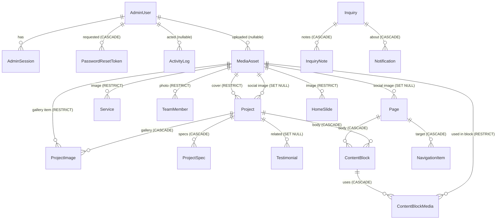

# Database Design (PostgreSQL + Prisma)

**Status:** PROPOSED. Nothing here is implemented. Every table traces to a feature in [FRONTEND_REQUIREMENTS_AUDIT.md](FRONTEND_REQUIREMENTS_AUDIT.md) (`F-xx`). Items that depend on an open question are marked with its ID.

---

## 1. Conventions

| Topic | Decision | Status |
|---|---|---|
| Engine | PostgreSQL 18 (Render's default for new databases; also installed locally, 18.6) | VERIFIED (Render docs, see INTEGRATIONS §4) |
| Primary keys | UUID (`@db.Uuid`), time-ordered **v7**, generated by Prisma (`@default(uuid(7))`). Rows inserted by the migration itself use `gen_random_uuid()` | VERIFIED in Phase 2 (test checks the version and ordering) |
| Timestamps | `created_at` / `updated_at` as `timestamptz(3)`, set by Prisma (`@default(now())`, `@updatedAt`) | PROPOSED |
| Calendar dates | Project dates as `date` (the frontend uses `YYYY-MM-DD`, `ProjectForm.tsx:63`) | PROPOSED |
| Naming | Prisma models in PascalCase, mapped to snake_case table and column names (`@@map`, `@map`) | PROPOSED |
| Text limits | Bounded fields use `varchar(n)`; long text uses `text`. The same limits are enforced in Zod and mirrored in the frontend | PROPOSED |
| Enums | Native PostgreSQL enums. Values the frontend writes with hyphens (`in-progress`, `on-hold`) are declared as `in_progress @map("in-progress")`. Prisma 7.3.0's release notes say the generated client uses the **schema** names (`in_progress`), but the v7 schema reference still says the opposite. The API maps `in_progress` ↔ `in-progress` in one serializer, and a Phase 2 test pins the behaviour. **Settled in Phase 2:** the generated client uses `in_progress`, the database stores `in-progress` (the release notes were right; the schema reference is stale). Conversion lives in `src/lib/enum-map.ts` | VERIFIED |
| ORM version | Prisma **7.10.1**, pinned exactly for `prisma`, `@prisma/client` and `@prisma/adapter-pg`. The `prisma` CLI's npm `latest` tag currently points to `8.0.0-rc.34`, so an unpinned install would mismatch the client | VERIFIED (npm registry, 2026-11-20) |
| Prisma 7 setup | Driver adapter required (`@prisma/adapter-pg`). Datasource URL goes in `prisma.config.ts` (not `schema.prisma`). `.env` is not auto-loaded. Generator `prisma-client` with a required `output`. ESM (`"type": "module"`) | VERIFIED (Prisma v7 upgrade guide) |
| Integrity rules Prisma can't express | `CHECK` constraints added by hand-editing the generated SQL migration (`prisma migrate dev --create-only`) | PROPOSED |
| Deletes | Hard deletes. No soft-delete column anywhere, because the frontend has no "trash" or restore UI | PROPOSED |

### Translatable fields (Q-02 answered: bilingual, **Georgian primary**)

Fields marked 🌐 below are the ones the frontend already translates for seed data (`client/i18n/resources.ts:62-79`). The sketches show each as a single field for readability. **In the real schema every 🌐 field `x` becomes two columns:**

| Column | Rule | Status |
|---|---|---|
| `xKa` | **Required** (same length limits as listed) | DECIDED that Georgian is primary; required-ness PROPOSED, Q-02a(1) |
| `xEn` | Optional (nullable). When empty, the English site shows the Georgian text | PROPOSED, Q-02a(1) |
| String arrays (`features`) | Become `featuresKa String[]` (required, ≥ 1 item if any English items exist) and `featuresEn String[]` (may be empty) | PROPOSED |

- The public API resolves the language from `?locale=` (API_CONTRACTS §1) and returns plain field names (`title`, …). The admin API sends and receives both columns.
- **Why typed `*Ka`/`*En` columns rather than a translation table:** there are exactly two fixed languages. That gives typed columns, simple queries and no joins. If a third language is ever added, convert to a translation table.
- **Not translated:** slugs (one per record, Latin), `architect` (a proper name, as the prototype already treats it, `client/i18n/content.ts:9-10`), media `filename`, settings `companyName`, emails, phones, URLs.

### Slugs for Georgian titles

The prototype's `slugify` keeps only `a-z0-9` (`client/lib/format.ts`), so a Georgian title produces an **empty** slug.

- The server and admin form generate slugs by **transliterating Georgian to Latin** first, using the national romanization (one fixed 33-letter table, no dependency). Example: "ვაკის ტერასები" → `vakis-terasebi`.
- The admin can still edit the slug by hand. Uniqueness and the slug pattern are enforced as before.

---

## 2. Entity relationship overview



`SiteSettings` is a standalone single-row table (with an optional link to a default social image). `Redirect` is standalone.

The CMS entities (`Page`, `ContentBlock`, `ContentBlockMedia`, `NavigationItem`, `HomeSlide`, `Redirect`) were added on 2026-11-20 for the client requirements (§3.9–3.12).

---

## 3. Models

The sketch below is in Prisma syntax for readability. It is not final code: the generator and datasource blocks depend on the Prisma version (INTEGRATIONS §5), and `@map` details are omitted for brevity.

### 3.1 Authentication (F-01)

```prisma
model AdminUser {
  id               String         @id @db.Uuid
  email            String         @unique @db.VarChar(254)   // stored lower-cased
  name             String         @db.VarChar(100)
  passwordHash     String                                     // Argon2id PHC string
  failedLoginCount Int            @default(0)
  lockedUntil      DateTime?      @db.Timestamptz(3)
  lastLoginAt      DateTime?      @db.Timestamptz(3)
  passwordChangedAt DateTime?     @db.Timestamptz(3)
  createdAt        DateTime       @default(now()) @db.Timestamptz(3)
  updatedAt        DateTime       @updatedAt @db.Timestamptz(3)
  sessions         AdminSession[]
}

model AdminSession {
  id         String    @id @db.Uuid
  userId     String    @db.Uuid
  user       AdminUser @relation(fields: [userId], references: [id], onDelete: Cascade)
  tokenHash  String    @unique @db.Char(64)   // SHA-256 hex of the cookie token; raw token never stored
  createdAt  DateTime  @default(now()) @db.Timestamptz(3)
  lastSeenAt DateTime  @db.Timestamptz(3)
  expiresAt  DateTime  @db.Timestamptz(3)     // absolute expiry
  userAgent  String?   @db.VarChar(400)
  @@index([userId])
  @@index([expiresAt])
}

model PasswordResetToken {              // Q-06: reset link sent to the admin's registered email
  id        String    @id @db.Uuid
  userId    String    @db.Uuid          // CASCADE
  tokenHash String    @unique @db.Char(64)  // SHA-256 hex; raw token only ever in the emailed link
  expiresAt DateTime  @db.Timestamptz(3)    // created + 30 minutes
  usedAt    DateTime? @db.Timestamptz(3)    // single use
  createdAt DateTime  @default(now()) @db.Timestamptz(3)
  @@index([userId])
}
```

**Why these tables exist:**
- `AdminUser` replaces the hard-coded demo credentials (`client/lib/session.ts:8`). There is no `role` column: one admin for now (Q-06 decided). Add roles only if that changes.
- `AdminSession` gives server-side sessions that can be revoked; the reasoning is in SECURITY_PLAN §2.
- The lockout columns support the brute-force control in SECURITY_PLAN §3.
- `PasswordResetToken` exists because you chose email reset (Q-06).
  - Requesting a new token invalidates the user's unused ones.
  - A successful reset marks the token used and deletes all of that user's sessions.
  - Expired or used rows are removed by the hourly cleanup job.

### 3.2 Media (F-09)

```prisma
enum MediaKind     { IMAGE  VIDEO }
enum MediaProvider { CLOUDFLARE_IMAGES  CLOUDFLARE_STREAM  STATIC }   // Images pending Q-04; Stream pending Q-25
enum MediaStatus   { PENDING  PROCESSING  READY  FAILED }             // PROCESSING/FAILED apply to video encoding
enum MediaCategory { exterior  interior  construction  team  uploads }

model MediaAsset {
  id           String        @id @db.Uuid
  kind         MediaKind     @default(IMAGE)
  provider     MediaProvider
  providerKey  String        @db.VarChar(300)  // Cloudflare image id / Stream video uid, or static path for dev seed
  status       MediaStatus   @default(PENDING)
  filename     String        @db.VarChar(255)
  alt          String        @db.VarChar(300)  // 🌐 image alt text; for video, the accessible title
  category     MediaCategory @default(uploads)
  width        Int                             // client-reported (Cloudflare details API has no dimensions)
  height       Int
  bytes        Int
  mimeType     String        @db.VarChar(100)
  durationSeconds Int?                         // video only; from Cloudflare Stream once encoded
  uploadedById String?       @db.Uuid          // SET NULL when the admin is deleted
  createdAt    DateTime      @default(now()) @db.Timestamptz(3)
  updatedAt    DateTime      @updatedAt @db.Timestamptz(3)
  @@unique([provider, providerKey])
  @@index([status, category, createdAt(sort: Desc)])
}
```

- **`STATIC` provider:** lets the development seed reuse the 38 images in `client/public/images` without uploading them. It is never used in production unless Q-10 decides to keep them.
- **`PENDING` → `READY`:** a row is created before the browser uploads, so every remote file always has a database record. Rows stuck in `PENDING` (abandoned uploads) are cleaned up by the sweep in INTEGRATIONS §1.6. This is how the plan prevents orphaned files.
- **Width and height:** Cloudflare's image-details response has no dimensions (VERIFIED, INTEGRATIONS §1). The browser already measures them (`MediaAdmin.tsx:23-28`) and sends them. Getting them wrong only affects layout, not security, so the plan accepts the client's values after validating their ranges.
- **Video (required by the client, CR-CMS-04):** uploaded videos are `kind = VIDEO` rows on the `CLOUDFLARE_STREAM` provider.
  - Their life cycle is `PENDING` (waiting for the browser upload) → `PROCESSING` (Cloudflare is encoding) → `READY` or `FAILED`.
  - Only `READY` media can be referenced by content.
  - **Embedded video links** (YouTube, Vimeo) are **not** media rows. They are data inside an embed block (§3.9), because nothing is stored or uploaded.
- **Alt text** is now used on the public site (CR-SEO-07). Today the library's alt text is edited but never shown publicly (audit §7.3).

### 3.3 Projects (F-02, F-03)

```prisma
enum ProjectCategory { residential  apartments  commercial  hospitality  renovation }
enum ProjectStatus   { planning  in_progress  completed  on_hold }   // hyphenated values handled per §1

model Project {
  id                  String          @id @db.Uuid
  slug                String          @unique @db.VarChar(80)
  title               String          @db.VarChar(120)   // 🌐
  summary             String          @db.VarChar(180)   // 🌐
  description         String          @db.Text           // 🌐 (≤ 10,000 chars in Zod)
  location            String          @db.VarChar(120)   // 🌐
  city                String          @db.VarChar(80)    // 🌐
  category            ProjectCategory
  status              ProjectStatus
  progress            Int             @db.SmallInt
  startDate           DateTime        @db.Date
  estimatedCompletion DateTime        @db.Date
  completionDate      DateTime?       @db.Date
  featured            Boolean         @default(false)
  architect           String          @default("") @db.VarChar(120)
  coverId             String          @db.Uuid           // RESTRICT
  isPublished         Boolean         @default(false)    // draft until published (CR-CMS-06/07)
  publishedAt         DateTime?       @db.Timestamptz(3) // first publication; kept when unpublished
  // SEO fields: the shared set in §3.9 (seoTitle 🌐, seoDescription 🌐, ogImageId, robotsIndex, robotsFollow)
  createdAt           DateTime        @default(now()) @db.Timestamptz(3)
  updatedAt           DateTime        @updatedAt @db.Timestamptz(3)
  gallery             ProjectImage[]
  specs               ProjectSpec[]
  blocks              ContentBlock[]                     // optional free content below the fixed sections (§3.9)
  testimonials        Testimonial[]
  @@index([coverId])
  @@index([isPublished, updatedAt(sort: Desc)])
}

model ProjectImage {               // ordered gallery
  projectId String @db.Uuid        // CASCADE
  mediaId   String @db.Uuid        // RESTRICT
  position  Int    @db.SmallInt
  @@id([projectId, position])
  @@unique([projectId, mediaId])
  @@index([mediaId])
}

model ProjectSpec {                // ordered key facts
  id        String @id @db.Uuid
  projectId String @db.Uuid        // CASCADE
  position  Int    @db.SmallInt
  label     String @db.VarChar(60)  // 🌐
  value     String @db.VarChar(120) // 🌐
  @@unique([projectId, position])
}
```

**CHECK constraints** (added in the migration SQL). These copy `ProjectForm.tsx:43-61` so bad data can't enter by any route:
- `progress BETWEEN 0 AND 100`
- `estimated_completion >= start_date`
- `completion_date IS NULL OR completion_date >= start_date`
- `status <> 'completed' OR (completion_date IS NOT NULL AND progress = 100)`
- `slug ~ '^[a-z0-9]+(-[a-z0-9]+)*$'`

**Why separate tables for specs and gallery** (not JSON or arrays):
- Both are ordered lists that the admin edits.
- The gallery must reference real media rows, so a deleted image is caught by a foreign key instead of becoming a broken URL. Today the frontend links by URL string (`MediaAdmin.tsx:39-45`).
- Specs as rows keep Prisma types and length limits. A JSON column would be untyped in the Prisma client.

**Publishing and SEO (added for the client requirements):**
- A new project starts as a **draft** (`isPublished = false`). Public endpoints return published projects only.
- The project's **H1 is its `title`**, which is editable. The SEO title is a separate optional override (§3.9).
- Changing the slug of a published project writes a `Redirect` row in the same transaction (§3.12).
- The fixed fields (description, specs, gallery, dates) stay, because cards, filters and the facts list depend on them. `blocks` adds optional free content, which is where a project's videos go.

**Deliberately absent** (not in the frontend, see audit §5): manual ordering and a categories table. Q-19 revisits ordering if "products" need it.

### 3.4 Services and team (F-04, F-05)

```prisma
model Service {
  id          String   @id @db.Uuid
  slug        String   @unique @db.VarChar(80)  // NEW: stable /services#anchor; the prototype derived it from the
                                                // English title (ServicesList.tsx:16), which fails for Georgian titles
  title       String   @db.VarChar(80)    // 🌐
  summary     String   @db.VarChar(200)   // 🌐
  description String   @db.VarChar(2000)  // 🌐
  features    String[]                    // 🌐 (featuresKa String[]); ≤ 12 items, each ≤ 100 chars (Zod)
  imageId     String   @db.Uuid           // RESTRICT
  visible     Boolean  @default(true)
  position    Int
  createdAt   DateTime @default(now()) @db.Timestamptz(3)
  updatedAt   DateTime @updatedAt @db.Timestamptz(3)
  @@index([position])
  @@index([imageId])
}

model TeamMember {
  id        String   @id @db.Uuid
  name      String   @db.VarChar(100)   // 🌐 (the Georgian seed translates names too)
  role      String   @db.VarChar(100)   // 🌐
  bio       String   @db.VarChar(600)   // 🌐
  photoId   String   @db.Uuid           // RESTRICT
  visible   Boolean  @default(true)
  position  Int
  createdAt DateTime @default(now()) @db.Timestamptz(3)
  updatedAt DateTime @updatedAt @db.Timestamptz(3)
  @@index([position])
  @@index([photoId])
}
```

**`position`:** the frontend's order is array order with move up/down (`ServicesAdmin.tsx:59-60`, `TeamAdmin.tsx:51-52`).
- The API takes the full ordered list of IDs and rewrites positions 0…n-1 in one transaction.
- There is no `UNIQUE(position)`: Prisma can't declare a deferrable constraint, and a non-deferrable one would make swaps fail mid-transaction. The service layer keeps positions contiguous instead, and tests check it.

### 3.5 Testimonials (F-06)

```prisma
model Testimonial {
  id        String   @id @db.Uuid
  quote     String   @db.VarChar(400)  // 🌐
  author    String   @db.VarChar(100)  // 🌐
  role      String   @db.VarChar(100)  // 🌐
  projectId String?  @db.Uuid          // SET NULL when the project is deleted
  published Boolean  @default(false)
  createdAt DateTime @default(now()) @db.Timestamptz(3)
  updatedAt DateTime @updatedAt @db.Timestamptz(3)
  @@index([published, createdAt(sort: Desc)])
}
```

**`projectId` replaces the free-text `project` title** (PROPOSED).
- The editor only offers existing project titles (`TestimonialsAdmin.tsx:166-176`), so a foreign key keeps the same behaviour.
- It also stays correct if the project is renamed. Today a rename silently breaks the link, because the testimonial stores the old title.

### 3.6 Inquiries, notes, notifications (F-07, F-08, F-14)

```prisma
enum InquiryStatus { new  in_progress  resolved }   // hyphenated value handled per §1

model Inquiry {
  id        String        @id @db.Uuid
  name      String        @db.VarChar(100)
  email     String        @db.VarChar(254)
  phone     String?       @db.VarChar(40)
  subject   String        @db.VarChar(120)
  message   String        @db.VarChar(5000)
  status    InquiryStatus @default(new)
  createdAt DateTime      @default(now()) @db.Timestamptz(3)
  updatedAt DateTime      @updatedAt @db.Timestamptz(3)
  notes         InquiryNote[]
  notifications Notification[]
  @@index([status, createdAt(sort: Desc)])
  @@index([createdAt(sort: Desc)])
}

model InquiryNote {
  id        String   @id @db.Uuid
  inquiryId String   @db.Uuid              // CASCADE
  text      String   @db.VarChar(2000)
  createdAt DateTime @default(now()) @db.Timestamptz(3)
  // authorId String? @db.Uuid             ← not needed with one admin (Q-06); add if more admins join
  @@index([inquiryId, createdAt])
}

enum NotificationType { NEW_INQUIRY }

model Notification {
  id        String           @id @db.Uuid
  type      NotificationType
  inquiryId String           @db.Uuid    // CASCADE: deleting an inquiry removes its notification
  read      Boolean          @default(false)
  createdAt DateTime         @default(now()) @db.Timestamptz(3)
  @@index([createdAt(sort: Desc)])
}
```

- **Notifications store a type and a link, not text.** The title ("New inquiry"), body ("name: subject") and link (`/admin/inquiries?id=…`) are built when the notification is read, so they can never go stale or point at a deleted inquiry. The prototype can do both today (`client/lib/store.ts:199-208`). Only `NEW_INQUIRY` is generated anywhere in the code (audit F-14).
- **Text search** over name, email, subject and message uses `ILIKE`. That is enough for thousands of rows. Add a `pg_trgm` index only if measurements in Phase 15 show the need.
- **Personal data:** see Q-12 for retention. The plan stores **no IP address** with an inquiry; rate limiting uses memory only (SECURITY_PLAN §5).
- **Email outbox (`EmailMessage`):** created in **Phase 9**, for inquiry emails.
  - Fields: recipient, template, locale, payload JSON, status (`pending`/`sent`/`failed`), attempts, `nextAttemptAt`, `lastError`, timestamps; index on `(status, nextAttemptAt)`.
  - It exists because a lost inquiry notification can't be re-sent by the visitor, so it must be retried durably.
  - **Password-reset emails do not use the outbox.** They are sent directly after the token is committed (one retry), because:
    - storing the email payload would put a usable reset link in the database
    - the admin is waiting and can simply request a new link
  - Phase 10 connects the real Gmail transport for both.

### 3.7 Activity log (F-13)

```prisma
enum ActivityKind { project  inquiry  service  testimonial  team  media  settings  auth  page  navigation  slide  redirect }

model ActivityLog {
  id        String       @id @db.Uuid
  kind      ActivityKind
  message   String       @db.VarChar(300)   // English, server-generated (admin is English-only)
  actorId   String?      @db.Uuid           // SET NULL; null for public events (new inquiry)
  createdAt DateTime     @default(now()) @db.Timestamptz(3)
  @@index([createdAt(sort: Desc)])
}
```

- This doubles as the audit log. `auth` is added beyond the frontend's kinds to record sign-ins and failed lockouts. The dashboard filters `auth` entries out, so the visible feed stays as it is today.
- Retention: keep everything; reads use `LIMIT`. Revisit if the table passes ~100k rows.

### 3.8 Site settings (F-10)

```prisma
model SiteSettings {
  id           Int      @id @default(1) @db.SmallInt   // CHECK (id = 1): exactly one row
  companyName  String   @db.VarChar(24)
  tagline      String   @db.VarChar(40)    // 🌐
  email        String   @db.VarChar(254)
  phone        String   @db.VarChar(40)
  address      String   @db.VarChar(200)   // 🌐
  hours        String   @db.VarChar(100)   // 🌐
  instagramUrl String   @default("") @db.VarChar(300)
  linkedinUrl  String   @default("") @db.VarChar(300)
  facebookUrl  String   @default("") @db.VarChar(300)

  // Contact channels (CR-PW-04 to CR-PW-06). Empty = the button is not shown.
  whatsappNumber     String  @default("") @db.VarChar(20)   // digits only, international format, no "+"
  messengerUsername  String  @default("") @db.VarChar(100)  // Facebook Page username for m.me links
  mapUrl             String  @default("") @db.VarChar(500)  // Google Maps link to the office (https only)
  latitude           Decimal? @db.Decimal(9, 6)             // optional; used for LocalBusiness structured data
  longitude          Decimal? @db.Decimal(9, 6)

  // SEO and analytics (CR-SEO-06, CR-SEO-11, CR-SEO-14, CR-AN-01/02). Empty = feature off.
  defaultSeoDescription    String  @default("") @db.VarChar(300)  // 🌐 site-wide fallback description
  defaultOgImageId         String? @db.Uuid                       // SET NULL; fallback social sharing image
  googleSiteVerification   String  @default("") @db.VarChar(100)  // Search Console HTML-tag token
  gtmContainerId           String  @default("") @db.VarChar(20)   // "GTM-XXXXXXX"; GA4 is configured inside GTM

  updatedAt    DateTime @updatedAt @db.Timestamptz(3)
}
```

- **`theme` is deliberately excluded:** it is a per-browser preference (audit F-11, Q-16).
- The migration inserts the single row with the real company name, email and address from `client/data/seed.ts:685-696`. The phone and hours there are placeholders (`seed.ts:1-3`) and are marked as such in the seed.
- **Format checks** (Zod, plus `CHECK` constraints where simple):
  - `whatsappNumber`: 8–15 digits
  - `messengerUsername`: letters, digits and dots only
  - `mapUrl`: an `https://` URL on a Google Maps host
  - `gtmContainerId`: `^GTM-[A-Z0-9]+$`
  - `googleSiteVerification`: letters, digits, `_` and `-` only
- **Why the Tag Manager ID and verification token are settings, not environment variables (PROPOSED):** the client can set them without a developer or a redeploy, and staging simply leaves them empty, so staging never sends analytics.

### 3.9 Pages, content blocks and shared SEO fields (CR-CMS-03 to CR-CMS-07, CR-SEO-01 to CR-SEO-06)

```prisma
enum PageKind { SYSTEM  CUSTOM }
enum SystemPageKey { home  projects  services  about  contact }

model Page {
  id          String         @id @db.Uuid
  kind        PageKind       @default(CUSTOM)
  systemKey   SystemPageKey? @unique        // set only for the five built-in pages
  slug        String         @unique @db.VarChar(80)   // custom pages: /<slug>; system pages: fixed route
  title       String         @db.VarChar(120)          // 🌐 the page's H1
  intro       String         @default("") @db.VarChar(400)  // 🌐 optional lead paragraph under the H1
  isPublished Boolean        @default(false)           // system pages are always published (CHECK)
  publishedAt DateTime?      @db.Timestamptz(3)

  // Shared SEO fields (the same five exist on Project)
  seoTitle       String  @default("") @db.VarChar(70)   // 🌐 empty = use `title` + site name
  seoDescription String  @default("") @db.VarChar(200)  // 🌐 empty = automatic default (see below)
  ogImageId      String? @db.Uuid                       // SET NULL; empty = automatic default
  robotsIndex    Boolean @default(true)                 // false → <meta name="robots" content="noindex">
  robotsFollow   Boolean @default(true)

  createdAt   DateTime       @default(now()) @db.Timestamptz(3)
  updatedAt   DateTime       @updatedAt @db.Timestamptz(3)
  blocks      ContentBlock[]
  navItems    NavigationItem[]
}

enum BlockType { heading  text  image  gallery  video  embed }

model ContentBlock {
  id        String    @id @db.Uuid
  pageId    String?   @db.Uuid      // CASCADE   ┐ exactly one of the two is set
  projectId String?   @db.Uuid      // CASCADE   ┘ (CHECK constraint)
  position  Int       @db.SmallInt
  type      BlockType
  data      Json                    // shape depends on `type`; validated by Zod on every write
  media     ContentBlockMedia[]
  @@index([pageId, position])
  @@index([projectId, position])
}

model ContentBlockMedia {           // which library items a block uses, in order
  blockId  String @db.Uuid          // CASCADE
  mediaId  String @db.Uuid          // RESTRICT
  position Int    @db.SmallInt
  @@id([blockId, position])
  @@index([mediaId])
}
```

**Pages:**
- **System pages** are the five routes that exist today. Their designed layouts stay. The `Page` row gives each one an editable H1, intro, SEO fields and (optionally) free blocks. They can't be deleted or unpublished, and their slugs are fixed.
- **Custom pages** are new pages built entirely from blocks (for example a privacy policy or a careers page), served at `/<slug>`.
  - Reserved slugs are refused: `admin`, `api`, `en`, `ka`, `projects`, `services`, `about`, `contact`, plus the framework's own paths.
- How much of the existing designed pages should become editable is the largest open scope question (Q-21).

**Block types (MVP).** The `data` JSON for each, with 🌐 text stored as `{ ka, en }`:

| Type | `data` | Media rows |
|---|---|---|
| `heading` | `{ level: 2 \| 3, text 🌐 }` | — |
| `text` | `{ doc 🌐 }`, a rich-text document as structured JSON (never HTML). Allowed: paragraphs, bold, italic, links, bullet and numbered lists (Q-22) | — |
| `image` | `{ caption 🌐 }` | exactly 1 image |
| `gallery` | `{}` | 2–30 images |
| `video` | `{ caption 🌐 }` | exactly 1 video (uploaded, Cloudflare Stream) |
| `embed` | `{ provider: "youtube" \| "vimeo", videoId, title 🌐 }` | — |

- **Why blocks are rows plus a media link table, not one JSON blob per page:** media used inside blocks stays protected by a foreign key (an image used in a block can't be deleted, and "used by" works), and blocks keep a stable order.
- **Heading levels are limited to H2 and H3.** The page's single H1 is always its `title`, so the heading hierarchy can't be broken from the editor (CR-SEO-04).
- **Embeds store a provider and a video ID, never a URL or HTML.** The server parses the pasted link, accepts only known YouTube and Vimeo link shapes, and the site builds the player address itself (SECURITY_PLAN §17).
- **Limits:** at most 60 blocks per page or project; `data` at most 50 kB per block.

**Automatic SEO defaults (CR-SEO-14).** Every SEO field is optional. When one is empty, the public API fills the value in this order:

| Field | Project | Page |
|---|---|---|
| Title | `seoTitle` → `title` | `seoTitle` → `title` |
| Description | `seoDescription` → `summary` | `seoDescription` → `intro` → first 160 characters of the first text block → site default |
| Social image | `ogImageId` → cover image | `ogImageId` → first image in the blocks → site default image |
| Indexing | `robotsIndex` / `robotsFollow` (default on) | same |

**Publishing rules:**
- Draft = `isPublished = false`. Drafts appear only in the admin and in preview (API_CONTRACTS §8).
- Saving a published item changes the live site immediately. Keeping a separate "draft of changes" for something already published needs version history, which is a **future enhancement**, not MVP.
- Services, team members and testimonials keep their existing `visible` / `published` switches. They are list items, not pages, so they have no SEO fields.

**Preview tokens (CR-CMS-07):**

```prisma
model PreviewToken {
  id         String    @id @db.Uuid
  tokenHash  String    @unique @db.Char(64)   // SHA-256 hex; the raw token exists only in the preview link
  targetType String    @db.VarChar(10)        // "project" or "page"
  targetId   String    @db.Uuid
  expiresAt  DateTime  @db.Timestamptz(3)     // created + 5 minutes
  usedAt     DateTime? @db.Timestamptz(3)     // single use
  createdAt  DateTime  @default(now()) @db.Timestamptz(3)
}
```

- It follows the same pattern as password-reset tokens: random, hashed, short-lived, single use. Expired rows are removed by the hourly cleanup job.
- It has no foreign key to the target on purpose: the token is checked against the record when it is used, and a deleted record simply makes the token useless.
- The flow is in API_CONTRACTS §8.8.

### 3.10 Navigation (CR-PW-08, CR-CMS-02)

```prisma
enum NavLocation { HEADER  FOOTER }

model NavigationItem {
  id        String      @id @db.Uuid
  location  NavLocation
  label     String      @db.VarChar(40)    // 🌐
  pageId    String?     @db.Uuid           // CASCADE  ┐ exactly one of the two is set
  url       String?     @db.VarChar(500)   //          ┘ (CHECK): an internal path or an https URL
  newTab    Boolean     @default(false)
  visible   Boolean     @default(true)
  position  Int
  @@index([location, position])
}
```

- Items point at a page (system or custom) or at a URL. An item whose page is unpublished is left out of the public menu automatically.
- **One level only** (no dropdown menus) in the MVP. The current design has a flat menu (`SiteHeader.tsx:16-23`). Q-23 confirms.
- The migration creates the current menu (Services, Projects, About in the header; all five in the footer), so nothing changes visually on day one.
- Reordering uses the same whole-list endpoint as services and team.

### 3.11 Homepage slider (CR-PW-02, CR-CMS-01)

```prisma
model HomeSlide {
  id          String   @id @db.Uuid
  imageId     String   @db.Uuid           // RESTRICT
  heading     String   @db.VarChar(120)   // 🌐
  text        String   @default("") @db.VarChar(300)  // 🌐
  ctaLabel    String   @default("") @db.VarChar(40)   // 🌐 empty = no button
  ctaUrl      String   @default("") @db.VarChar(500)  // internal path or https URL
  isPublished Boolean  @default(false)
  position    Int
  createdAt   DateTime @default(now()) @db.Timestamptz(3)
  updatedAt   DateTime @updatedAt @db.Timestamptz(3)
  @@index([isPublished, position])
}
```

- At most 8 slides (API limit), ordered by `position`.
- Slide headings are **not** H1s. The homepage's H1 is the home `Page` title.
- **Decided (Q-20):** the slider is its own section lower on the homepage. The current opening with the 3D house stays at the top and keeps the H1.

### 3.12 Redirects (CR-SEO-13)

```prisma
model Redirect {
  id        String   @id @db.Uuid
  fromPath  String   @unique @db.VarChar(300)  // locale-free path, e.g. /projects/old-slug
  toPath    String   @db.VarChar(300)          // locale-free internal path
  createdAt DateTime @default(now()) @db.Timestamptz(3)
}
```

- **Automatic:** when the slug of a **published** project or page changes, the same transaction:
  1. inserts `old path → new path`
  2. re-points any existing redirect that led to the old path, so chains never form
  3. deletes any redirect whose `fromPath` equals the new path, so a live address is never redirected away
- **Manual:** the admin can list, add and delete redirects.
- **Paths are locale-free** because slugs are shared between languages. The frontend applies a redirect to both the Georgian and the English address.
- **Internal targets only:** `toPath` must start with a single `/`. This rules out open redirects to other sites.
- All redirects are permanent. How they are served is in SEO_ANALYTICS_PERFORMANCE §6.

---

## 4. Referential behaviour summary

| Relation | On delete | Reason |
|---|---|---|
| Project/ProjectImage/Service/TeamMember → MediaAsset | **RESTRICT** | Deleting an in-use image would break public pages once the remote file is gone (Q-11 confirms the UX change) |
| ProjectImage, ProjectSpec → Project | CASCADE | Owned children |
| Testimonial → Project | SET NULL | The quote stays valid without the project |
| InquiryNote, Notification → Inquiry | CASCADE | Owned children; matches the "message and its notes will be permanently removed" copy (`InquiriesAdmin.tsx:122`) |
| AdminSession, PasswordResetToken → AdminUser | CASCADE | Sessions and reset tokens die with the account |
| ActivityLog.actor, MediaAsset.uploadedBy → AdminUser | SET NULL | Keep history when an admin is removed |
| ContentBlock → Page / Project | CASCADE | Blocks belong to their page or project |
| ContentBlockMedia → ContentBlock | CASCADE | Link rows belong to the block |
| ContentBlockMedia, HomeSlide → MediaAsset | **RESTRICT** | Same protection as covers and galleries |
| Page.ogImage, Project.ogImage, SiteSettings.defaultOgImage → MediaAsset | SET NULL | A social image is optional; the automatic default takes over |
| NavigationItem → Page | CASCADE | A deleted page disappears from the menus |

---

## 5. Transaction boundaries

| Operation | Inside one transaction | After commit |
|---|---|---|
| Create/update project | project row + replace specs + replace gallery rows + replace blocks and their media links + redirect row if a published slug changed + activity entry | Frontend cache revalidation (Phase 11) |
| Create/update page | page row + replace blocks and their media links + redirect row if a published slug changed + activity entry | revalidation |
| Publish / unpublish | flag + `publishedAt` (first time only) + activity entry | revalidation |
| Reorder navigation or slides | same as services and team | revalidation |
| Reorder services or team | verify the submitted ID set equals the stored set; rewrite all positions | revalidation |
| Submit inquiry | inquiry + notification + activity entry | Email outbox processing (Phase 10) |
| Delete media | usage check + delete row (foreign keys enforce it again) | Delete the remote file. If that fails, log it and leave the file for the orphan sweep (INTEGRATIONS §1.6) |
| Login | read user, verify password, update counters, create session, activity entry | — |
| Request password reset | invalidate unused tokens, insert new token hash, activity entry | Send the reset email directly (not via outbox) |
| Confirm password reset | mark token used, update password hash, delete all sessions, activity entry | Send the "your password was changed" notice |

Remote calls (Cloudflare, email) **never** run inside a database transaction, so a slow external service can't hold locks.

---

## 6. Query efficiency and pagination

- **Data volumes are small** today (12 projects, 7 services, 8 team members, 5 testimonials, 38 images, 10 inquiries in the seed).
  - Public lists of projects, services, team and testimonials return everything without pagination (PROPOSED). Revisit if any list passes about 200 items.
- **Paginated (offset/limit, default 25, max 100):** admin inquiries, media and activity. These are the lists that grow without limit, and the UI needs total counts (`InquiriesAdmin.tsx:37-41`, `MediaAdmin.tsx:67-71`), which offset pagination provides.
- **Avoiding N+1 queries:**
  - Project detail is one query with `include` for gallery (with media), specs and cover.
  - The public project list includes the cover only.
  - The dashboard runs `groupBy`/`count` queries (project status counts, inquiry month buckets) instead of loading rows.
- **Indexes:** only those listed above, each justified by a filter or sort the UI uses, or by a foreign-key lookup for media usage checks. Phase 15 runs `EXPLAIN ANALYZE` on the real queries with seed plus synthetic data before adding any more.

---

## 7. Migrations

1. Develop with `prisma migrate dev` against the local PostgreSQL 18. Migrations are committed under `server/prisma/migrations/`.
2. Every generated SQL file is reviewed. `CHECK` constraints and the settings row are added by hand via `--create-only`.
3. Deploy with `prisma migrate deploy` as Render's **pre-deploy command**. This is a paid-plan feature; a failure aborts the deploy (VERIFIED, INTEGRATIONS §4). The old version keeps serving until the migration succeeds.
4. Use expand/contract for breaking changes: add columns as nullable or with defaults, deploy code that writes both, backfill, then drop in a later release. This keeps a Render rollback safe, because a rollback restores code but **not** the database.
5. Never edit a migration that has already been applied. Fix problems forward.
6. CI checks that the schema and migrations agree (Phase 2 defines the exact command for the Prisma version in use).

## 8. Seeding

| Seed | Environment | Content |
|---|---|---|
| `prisma/seed.ts` (dev) | local, test fixtures, staging | Ported from `client/data/seed.ts`: placeholder projects, services, team, testimonials, inquiries; media rows with provider `STATIC` pointing at `client/public/images` |
| Settings row | all (in the migration) | Real company name, address and email; placeholder phone and hours flagged for replacement |
| Admin account | all | **Not** seeded with a known password. Created by a command-line script (`npm run admin:create`) that prompts for the password |

Production content: Q-10 decides whether the placeholder content is imported or production starts empty.

## 9. Connections, backups, recovery

- **One `PrismaClient` per process.** Connect with Render's **internal** database URL from the same region, so there is no public hop (VERIFIED, INTEGRATIONS §4).
  - Pool size is set on the pg driver adapter (`max`, default 10, VERIFIED in the Prisma v7 connection-pool docs). Keep 10 or fewer; the cheapest paid database allows 100 connections.
  - Interactive transactions default to `maxWait` 2 s and `timeout` 5 s (VERIFIED). Remote calls stay outside transactions (§5), so those defaults are enough.
  - Disconnect on `SIGTERM`.
- **Failed migrations:** `prisma migrate deploy` refuses to run while a failed migration is recorded. Recovery is `prisma migrate resolve --rolled-back <name>` (then fix forward) or `--applied <name>` (after completing it by hand) (VERIFIED, Prisma v7 docs). The runbook is in Phase 16.
- **Seeding:** in Prisma 7 the seed command lives in `prisma.config.ts` (`migrations.seed`) and runs only through `prisma db seed`; it no longer runs automatically after `migrate dev` (VERIFIED).
- **Backups:**
  - Render paid databases have point-in-time recovery: 3 days on the Hobby workspace, 7 days on Pro. Logical exports are kept 7 days. The **free database has no backups and expires after 30 days** (VERIFIED, INTEGRATIONS §4).
  - PROPOSED: also run a weekly `pg_dump` kept off-platform (e.g. in an R2 bucket) for longer retention. The script and its secret are added in Phase 16.
- **Restore drill:** before launch, restore a backup into a scratch database and run the readiness check and a smoke test against it (Phase 16 acceptance criterion).
